# How to run it

Everything you need to start the app on your own machine, step by step. It covers what to
install, the first start, how to check that every part is working, and the everyday commands:
stopping, updating, backing up, and fixing a start that goes wrong. To learn what the app does
once it's running, read [how_it_works.md](how_it_works.md).

> ⚡ **Done this before?** Three commands:
> `floci start --persist="$HOME/.floci/aws-state"`, then `docker compose up -d`, then open
> http://localhost:8080.

**Reading the diagrams.** Each colour means the same thing in every diagram:

        

**Contents**

The first start:

1. [What you need](#1-what-you-need)
2. [Start Floci, the home for the PDFs](#2-start-floci-the-home-for-the-pdfs)
3. [Put in your settings](#3-put-in-your-settings)
4. [Start everything](#4-start-everything)
5. [Check that it's running](#5-check-that-its-running)
6. [Sign up and tell it about your company](#6-sign-up-and-tell-it-about-your-company)
7. [Watch the first circulars go through](#7-watch-the-first-circulars-go-through)

Every day:

8. [Stop, start, and after a reboot](#8-stop-start-and-after-a-reboot)
9. [Change a setting, update the code, add workers](#9-change-a-setting-update-the-code-add-workers)
10. [Admin commands](#10-admin-commands)
11. [Your data: where it lives, backups, starting over](#11-your-data-where-it-lives-backups-starting-over)

For developers, and when it goes wrong:

12. [Run one service by hand](#12-run-one-service-by-hand)
13. [When it doesn't start](#13-when-it-doesnt-start)
14. [All the commands on one page](#14-all-the-commands-on-one-page)

---

## 1. What you need

Most of the app runs in Docker, from this repo's `docker-compose.yml`. Two things live
outside it: **Floci**, a stand-in for Amazon S3 that keeps the PDFs on your machine, and
**Gemini**, Google's model, reached over the internet.

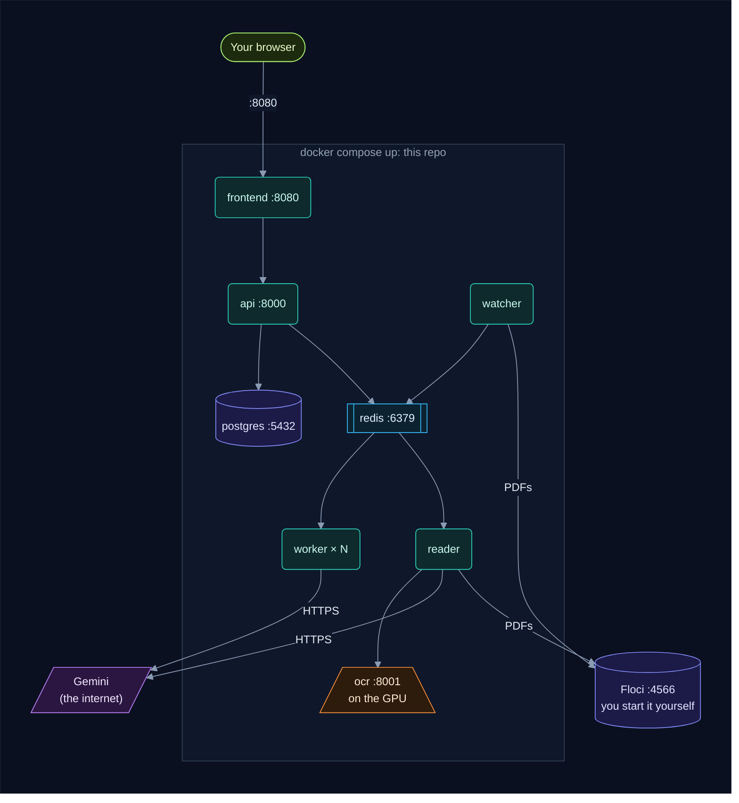

| You need | What it's for | Check it with |
|---|---|---|
| Linux and an NVIDIA GPU with 8 GB or more | the OCR model reads the PDFs on it | `nvidia-smi` |
| Docker, with Compose v2 | runs every part | `docker compose version` |
| Docker's NVIDIA runtime | lets the `ocr` container use the GPU | `docker info` lists `nvidia` under Runtimes |
| [Floci](https://github.com/floci-io/floci) | keeps the PDFs, like Amazon S3 would | `floci --version` |
| The AWS CLI (optional) | makes the bucket in step 2; uv can do it instead | `aws --version` |
| [uv](https://docs.astral.sh/uv/) | the admin commands, and running a service by hand | `uv --version` |
| A Gemini API key | Gemini sums up each circular and answers the questions. Make one at https://ai.google.dev/gemini-api | |
| About 40 GB of free disk | the first start downloads about 16 GB: the vLLM image (8.8 GB) and the OCR model (6.7 GB), both bigger once unpacked | `df -h` |
| These ports free: 5432, 6379, 8000, 8001, 8080, 4566 | Postgres, Redis, the api, OCR, the console, Floci | `ss -ltn` |

> 🎮 **The NVIDIA runtime.** The snap Docker (`sudo snap install docker`) sets it up by
> itself once the NVIDIA driver is installed. With Docker's own packages, install the
> [NVIDIA Container Toolkit](https://docs.nvidia.com/datacenter/cloud-native/container-toolkit/latest/install-guide.html),
> then run:
>
> ```bash
> sudo nvidia-ctk runtime configure --runtime=docker
> sudo systemctl restart docker
> ```
>
> The OCR server's flags are set for an 8 GB card. On 16 GB or more you can drop three of
> them: see [backend/ocr/README.md](backend/ocr/README.md).

Then get the code:

```bash
git clone https://github.com/selvakumarperumal/Regulatory_Circular_Impact_Agent.git
cd Regulatory_Circular_Impact_Agent
```

Every command in this guide is run from this folder, unless it starts with a `cd`.

---

## 2. Start Floci, the home for the PDFs

The watcher saves each new circular's PDF in S3, and the reader reads it back from there.
Floci plays S3 on your machine. It runs outside the compose file, so you start it yourself.

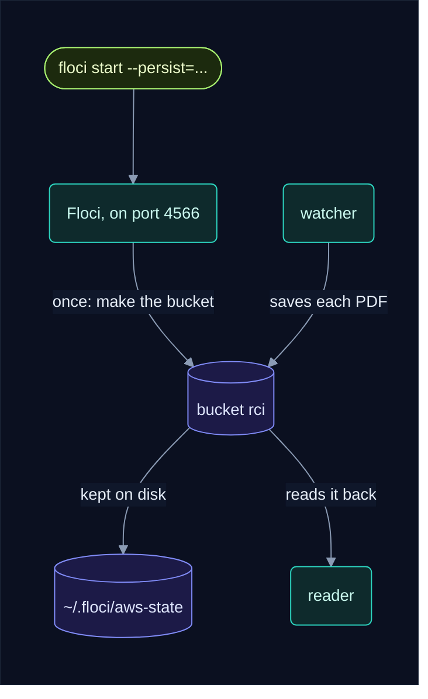

Start it:

```bash
floci start --persist="$HOME/.floci/aws-state"
```

- **`--persist`** keeps the PDFs in that folder. Without it, Floci keeps them in memory, and
  they're gone when it stops.
- Write `$HOME`, not `~`: bash leaves a `~` after `=` as it is.

Make the bucket, once. It's kept in the same folder, so you never need to do this again:

```bash
AWS_ACCESS_KEY_ID=test AWS_SECRET_ACCESS_KEY=test \
  aws --endpoint-url http://localhost:4566 --region us-east-1 s3 mb s3://rci
```

No AWS CLI? The watcher's Python has boto3, so uv can make it instead:

```bash
(cd backend/watcher && uv run python -c "import boto3; boto3.client('s3', endpoint_url='http://localhost:4566', aws_access_key_id='test', aws_secret_access_key='test', region_name='us-east-1').create_bucket(Bucket='rci')")
```

Check it worked. `floci status` should say `Reachable: yes`, and the list of buckets should
show `rci`:

```bash
floci status
AWS_ACCESS_KEY_ID=test AWS_SECRET_ACCESS_KEY=test \
  aws --endpoint-url http://localhost:4566 --region us-east-1 s3 ls
```

`test` isn't a secret: Floci takes any keys.

---

## 3. Put in your settings

Copy the example file, then open `.env` and put your key after `GEMINI_API_KEY=`:

```bash
cp .env.example .env
```

That's the only setting you must fill in. An empty setting uses the default written in that
service's `config.py`.

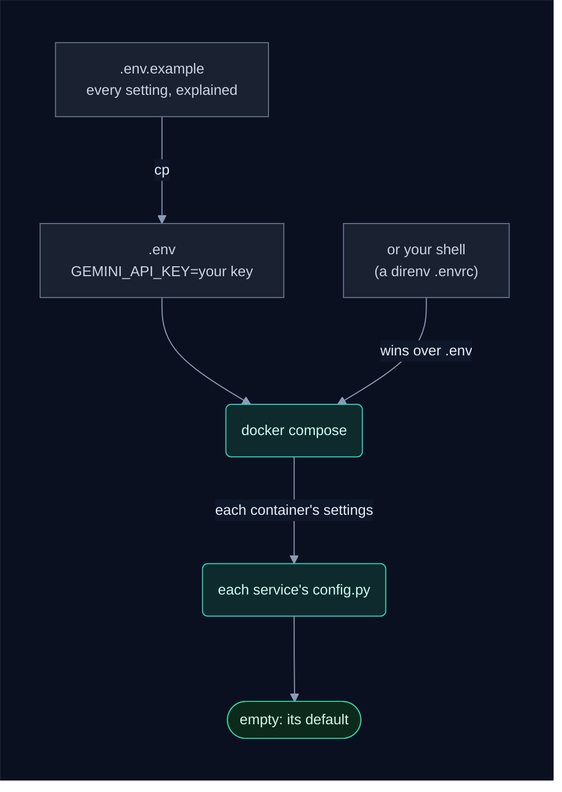

Settings you might change on day one:

| Setting | Default | What it changes |
|---|---|---|
| `GEMINI_MODEL_NAME` | `gemini-3.5-flash` | the model that answers the questions |
| `LOOKBACK_DAYS` | 30 | circulars older than this are skipped, not read |
| `WORKERS` | 1 | how many workers take the quick tasks, side by side |
| `WATCH_INTERVAL_MINUTES` | 60 | how often the watcher visits RBI, SEBI and IRDAI |
| `POSTGRES_PORT`, `REDIS_PORT`, `API_PORT`, `FRONTEND_PORT` | 5432, 6379, 8000, 8080 | the ports on your machine, if another program has one of these |

Every setting is in [.env.example](.env.example), and
[Where settings come from](how_it_works.md#20-where-settings-come-from) explains them all.

- 🔑 **Prefer the key in your shell?** Compose reads your shell too, and the shell wins over
  `.env`. So a direnv `.envrc` that exports `GEMINI_API_KEY` works as well. Git ignores both
  `.env` and `.envrc`, so your key never reaches GitHub.
- 🗄️ **`POSTGRES_USER`, `POSTGRES_PASSWORD` and `POSTGRES_DB`** are used once, when the
  database is first made. To change them later, the database has to be made again, which
  deletes its data (see [step 11](#11-your-data-where-it-lives-backups-starting-over)).

---

## 4. Start everything

```bash
docker compose up -d --build
```

`-d` runs it in the background. `--build` builds our images, from the code in this folder.

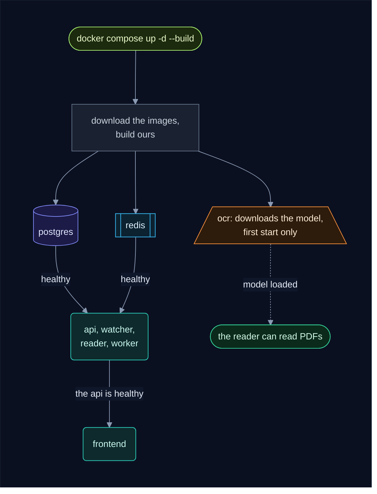

What happens, in order:

1. **Images.** The first time, Docker downloads Postgres, Redis, nginx, Python and the vLLM
   image (8.8 GB), then builds ours: the watcher, the worker (the reader uses the same
   image), the api and the console. Later starts skip this.
2. **Postgres and Redis** start first. The api, the watcher, the reader and the worker wait
   until both are healthy.
3. **The api** makes the database tables on its first start. **The console** waits for the
   api.
4. **The watcher** starts its first round at once, so circulars start arriving within a
   minute or two.
5. **OCR** downloads its model (6.7 GB) into the volume `rci_hf-cache`, on the first start
   only. Until the model is loaded, the reader says `OCR or Gemini unavailable; retrying`
   once a minute. Everything else works in the meantime.

To follow the model's download:

```bash
docker compose logs -f ocr      # Ctrl+C stops following; the container keeps running
```

---

## 5. Check that it's running

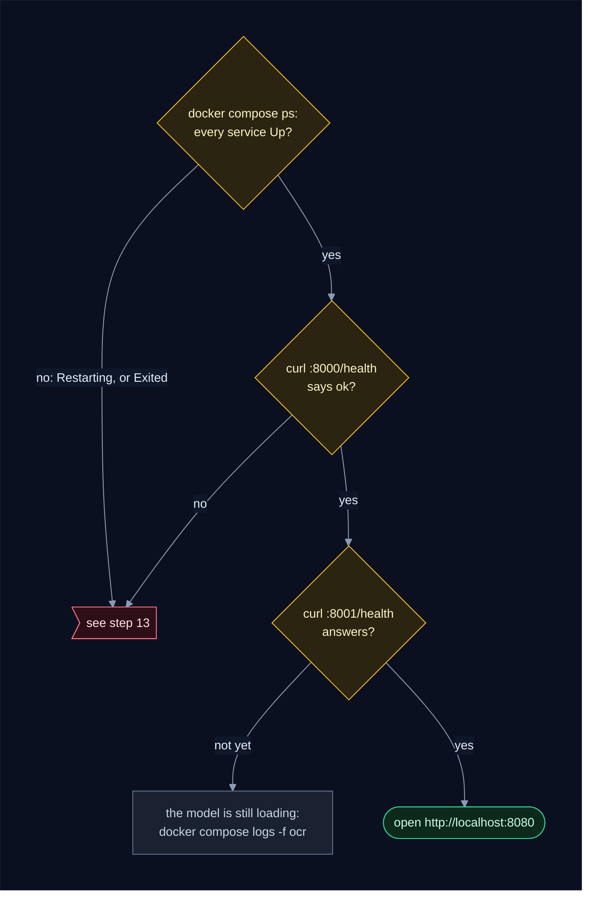

```bash
docker compose ps --format "table {{.Service}}\t{{.Status}}"
curl localhost:8000/health                              # {"status":"ok"}: the api reaches Postgres
curl -fsS localhost:8001/health && echo "OCR ready"     # answers once the model is loaded
floci status                                            # Reachable: yes
```

When all is well, `docker compose ps` shows every service `Up`. The five that have a health
check also say `(healthy)`:

```
SERVICE    STATUS
api        Up 3 minutes (healthy)
frontend   Up 3 minutes (healthy)
ocr        Up 3 minutes (healthy)
postgres   Up 3 minutes (healthy)
reader     Up 3 minutes
redis      Up 3 minutes (healthy)
watcher    Up 3 minutes
worker     Up 3 minutes
```

- `ocr` says `(health: starting)` while its model downloads and loads. It has 20 minutes
  before it counts as unhealthy.
- `Restarting` or `Exited` anywhere means a part can't start: see
  [step 13](#13-when-it-doesnt-start).

Two pages to open:

- http://localhost:8080: **the console**, where your team works.
- http://localhost:8000/docs: **the API's own page**, where you can try every endpoint.

---

## 6. Sign up and tell it about your company

The agent knows nothing about your company until you tell it. That takes three steps in the
console.

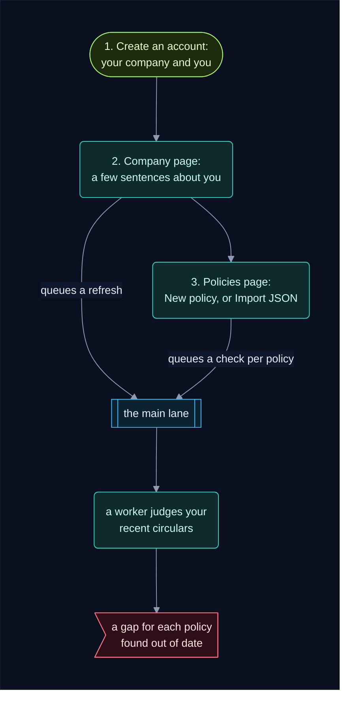

1. **Create an account.** Open http://localhost:8080 and choose **Create an account**. Give
   your company's name, your name, your email and a password of 8 characters or more. You
   become the company's first user.
2. **Describe your company.** On the **Company** page, write a few sentences on what kind of
   entity it is: a bank, an NBFC, an insurer, and what it does. Until you do, circulars are
   summed up, but nobody says which ones apply to you. See
   [What makes a good description](how_it_works.md#what-makes-a-good-description).
3. **Add your policies.** On the **Policies** page, use **New policy** for one, or **Import
   JSON** for a whole library (the file format is in [frontend/README.md](frontend/README.md)).
   Each policy says **Waiting for the worker** until it has been checked against your
   circulars of the last 30 days, then **Checked**.

Teammates are added on the **Company** page, under **Team**.

> 🗂️ **Ran it before on this machine?** Your data is still in the Docker volumes, so your old
> login still works. A login can also be made from the command line: see
> [step 10](#10-admin-commands).

---

## 7. Watch the first circulars go through

```bash
docker compose logs -f watcher reader worker
```

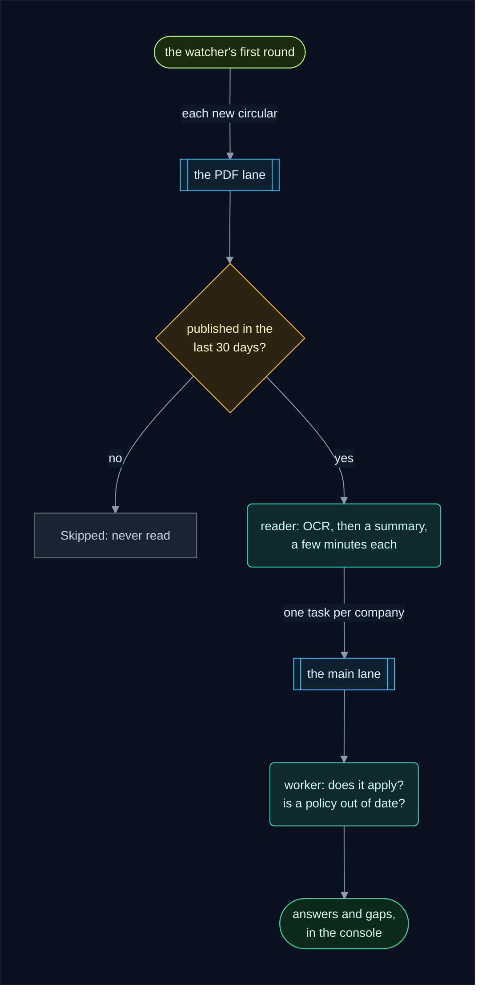

On a first start, the watcher saves every circular the regulators list. The older ones
(published more than `LOOKBACK_DAYS` ago) are marked **Skipped** in a moment, without being
read. The new ones are read one at a time, a few minutes each.

The lines you'll see, in order (the numbers are examples):

| From | The line | What it means |
|---|---|---|
| reader | `worker e02ff2af94f5-1: lanes pdf, using gemini-3.5-flash, waiting for tasks` | the reader is ready. Each worker says the same with `lanes main` |
| watcher | `RBI new: Master Direction – Know Your Customer …` | a new circular is saved, and a task put on the PDF lane |
| watcher | `RBI: seen=40 new=3 failed=0` | RBI is done; SEBI and IRDAI come next |
| watcher | `sleeping 60 minutes` | the round is over |
| reader | `pipeline #98 parsed: 12408 chars` | OCR has read the PDF |
| reader | `pipeline #98 read: addressed to 'All Commercial Banks'` | Gemini has summed it up |
| worker | `pipeline #98 vs POL-KYC v1 (0.74): GAP` | a policy was checked: `GAP` means out of date, `up to date` means it's fine |
| worker | `pipeline #98 for company 1: applies: True, gaps opened: ['POL-KYC']` | one company's answer for that circular |

To see only Gemini's decisions:

```bash
docker compose logs reader worker | grep pipeline
```

---

## 8. Stop, start, and after a reboot

| To | Run | What's kept |
|---|---|---|
| stop everything | `docker compose stop` | everything |
| start it again | `docker compose up -d` | |
| restart one part | `docker compose restart watcher` (the watcher starts a round at once) | |
| remove the containers | `docker compose down` | all your data: it's in the volumes |
| stop Floci | `floci stop` | the PDFs, in `~/.floci/aws-state` |

Stopping never loses work. Tasks wait in Redis, which keeps them on disk, and a task stopped
half-way carries on from what was saved. OCR, for example, carries on from the next unsaved
page.

**After a reboot**, most of it comes back by itself, but not all:

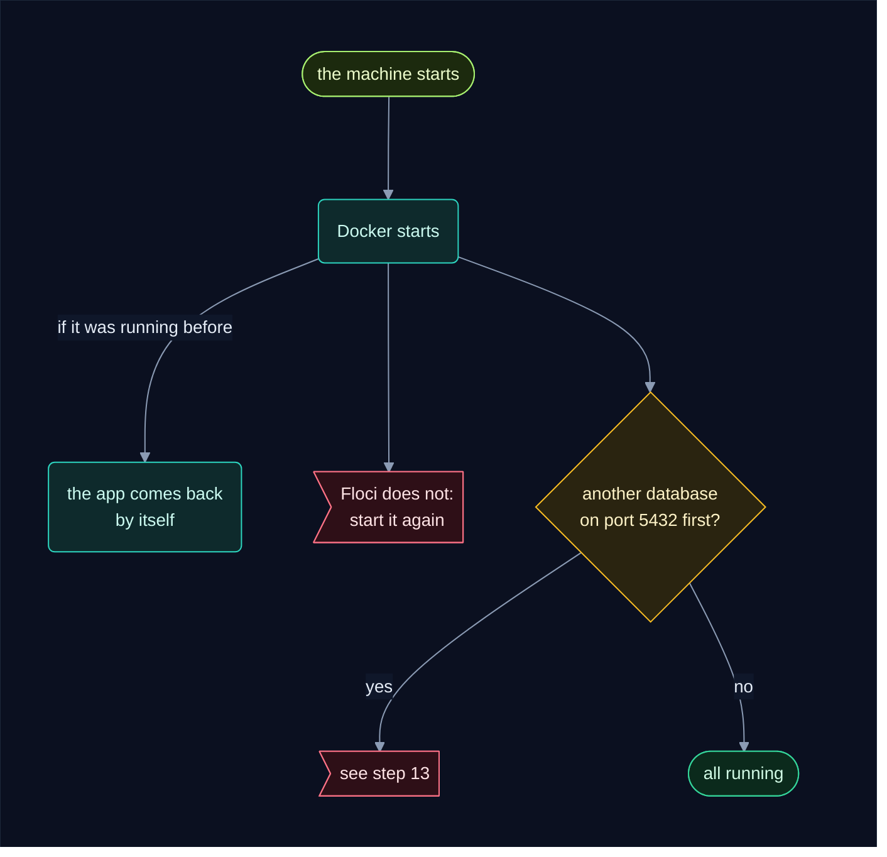

- **The app** comes back with Docker (`restart: unless-stopped`), if it was running when
  the machine went down. If you'd stopped it with `docker compose stop`, it stays stopped.
- **Floci** doesn't come back. Start it again with the command from
  [step 2](#2-start-floci-the-home-for-the-pdfs), with the same `--persist` folder. If its
  stopped container is still there, `docker start floci` works too. Until Floci is back, the
  watcher can't save PDFs, and a circular the reader was reading shows **Failed**. Press
  **Reprocess** on it afterwards.

---

## 9. Change a setting, update the code, add workers

After you edit `.env`, or pull new code with `git pull`, run the same command as the first
time:

```bash
docker compose up -d --build
```

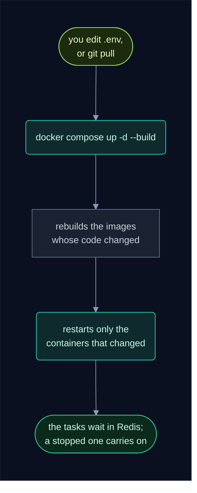

**More workers.** One worker takes the quick tasks (does a circular apply, is a policy out
of date) one at a time. To run three side by side, set this in `.env`, then run
`docker compose up -d`:

```bash
WORKERS=3
```

Go as high as your Gemini key's rate limit allows. Redis gives each task to one worker, so
no work is done twice. There's always exactly **one reader**: the GPU reads one page at a
time, and one reader never reads the same PDF twice. See
[Running several workers](how_it_works.md#running-several-workers).

**Look for new circulars now**, without waiting for the next round:

```bash
docker compose restart watcher
```

---

## 10. Admin commands

The admin commands live in `backend/api/manage.py`. They run on your machine with uv, and
reach Postgres and Redis through their ports (5432 and 6379).

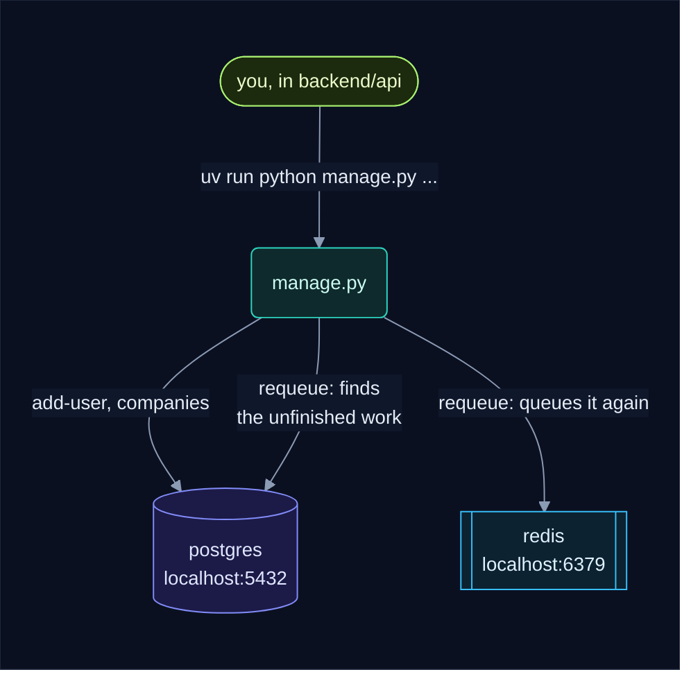

```bash
cd backend/api
uv run python manage.py companies                                         # every company, its id and its users
uv run python manage.py add-user you@company.com "Your Name" --company 1   # a login, or a new password
uv run python manage.py requeue                                           # only after Redis lost its data
```

- **`add-user`** asks for the password (or reads it from `RCI_PASSWORD`). For a login that
  already exists it sets a new password, so it's also how to reset a forgotten one.
- **`requeue`** is for after Redis lost its data, for example when its volume was deleted.
  It queues again every piece of work Postgres shows unfinished. Work still in the queue is
  left alone, so running it twice does no harm.
- 🔌 **Moved the ports** in step 3? Then copy `backend/api/.env.example` to `backend/api/.env`
  and put your ports in its `DATABASE_URL` and `REDIS_URL`.

Looking inside, from the repo's folder:

```bash
docker compose exec redis redis-cli XINFO GROUPS rci:tasks       # the main lane. lag: waiting, pending: being worked on
docker compose exec redis redis-cli XINFO GROUPS rci:tasks:pdf   # the PDF lane
docker compose exec redis redis-cli XRANGE rci:dead - +          # tasks that failed for good
docker compose exec postgres psql -U rci -d rci                  # the database, by hand (\q leaves)
```

---

## 11. Your data: where it lives, backups, starting over

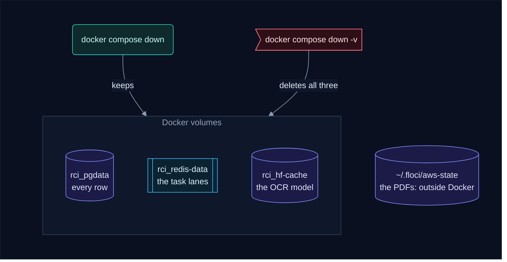

| What | Where | Gone with |
|---|---|---|
| everything in Postgres: circulars and their text, companies, logins, policies, answers, gaps | the volume `rci_pgdata` | `docker compose down -v` |
| the task lanes | the volume `rci_redis-data` | `docker compose down -v` (then run `manage.py requeue`) |
| the OCR model (6.7 GB) | the volume `rci_hf-cache` | `docker compose down -v` (then it downloads again) |
| the PDFs | `~/.floci/aws-state`, on your disk | deleting that folder |

> ⚠️ **`docker compose down -v` deletes all three volumes**: every company, policy and gap,
> and the model. Plain `docker compose down` keeps them.

**Back up the database:**

```bash
mkdir -p backups
docker compose exec -T postgres pg_dump -U rci -d rci > backups/rci-$(date +%F).sql
```

Git ignores `backups/`. `-T` passes the output through untouched, without the terminal
formatting Docker adds by default.

**Restore a backup** into a new, empty database. This replaces everything in the database
with the backup:

```bash
docker compose down
docker volume rm rci_pgdata                 # the old database
docker compose up -d --wait postgres        # a new, empty one; --wait waits until it's healthy
docker compose exec -T postgres psql -U rci -d rci < backups/rci-2026-10-24.sql
docker compose up -d
(cd backend/api && uv run python manage.py requeue)   # queue the backup's unfinished work
```

Postgres starts alone first, so the api doesn't make empty tables before the backup is put
back.

**Start over** with no data, keeping the model:

```bash
docker compose down
docker volume rm rci_pgdata rci_redis-data
docker compose up -d
```

Then sign up again ([step 6](#6-sign-up-and-tell-it-about-your-company)). The watcher finds
the circulars again on its first round.

---

## 12. Run one service by hand

When you change a service's code, you can run that one on your machine with uv instead of
in Docker. It reaches everything else through the ports on your machine.

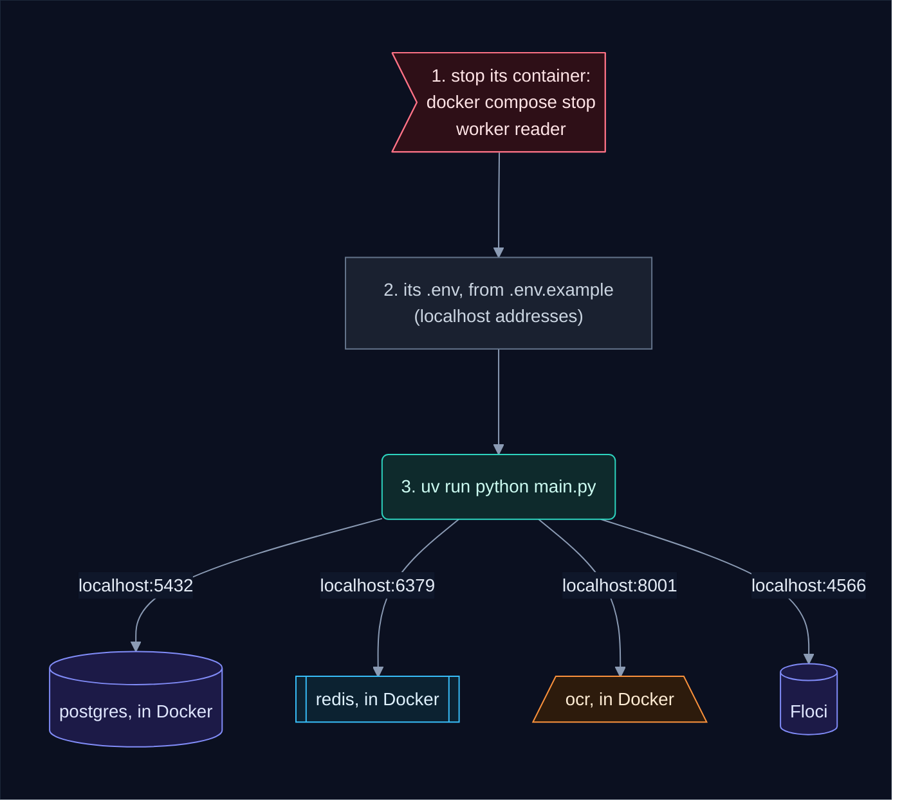

The worker, for example:

```bash
docker compose up -d postgres redis ocr     # what it needs (and Floci, from step 2)
docker compose stop worker reader           # the containers it replaces
cd backend/worker
cp .env.example .env                        # localhost addresses; put in GEMINI_API_KEY
uv sync
uv run python main.py                       # both lanes in one process; --once stops when both are empty
```

| Service | Stop its container | Run, in its folder | Notes |
|---|---|---|---|
| worker | `docker compose stop worker reader` | `uv run python main.py` | takes both lanes (`LANES=pdf,main`). To keep the reader in Docker, set `LANES=main` in its `.env`: never run two readers |
| api | `docker compose stop api` | `uv run uvicorn main:app --reload` | http://localhost:8000/docs. The console in Docker can't reach it, so serve the console by hand too (last row) |
| watcher | `docker compose stop watcher` | `uv run python main.py` | its `.env.example` has `INTERVAL_MINUTES=0`: one round, then it stops. `--only RBI` visits one regulator |
| frontend | nothing | `python3 -m http.server 5500` | http://localhost:5500. It calls the api at http://localhost:8000 (see `frontend/config.js`) |

- Each service reads the `.env` beside its `main.py`. Settings in your shell win over it.
- Moved the ports in step 3? Change the addresses in that `.env` too.
- After you change `backend/common/pyproject.toml`, run `uv lock && uv sync` in
  `backend/api`, `backend/worker` and `backend/watcher`.
- Done? `docker compose up -d --build` puts the stopped containers back, with your new code.

---

## 13. When it doesn't start

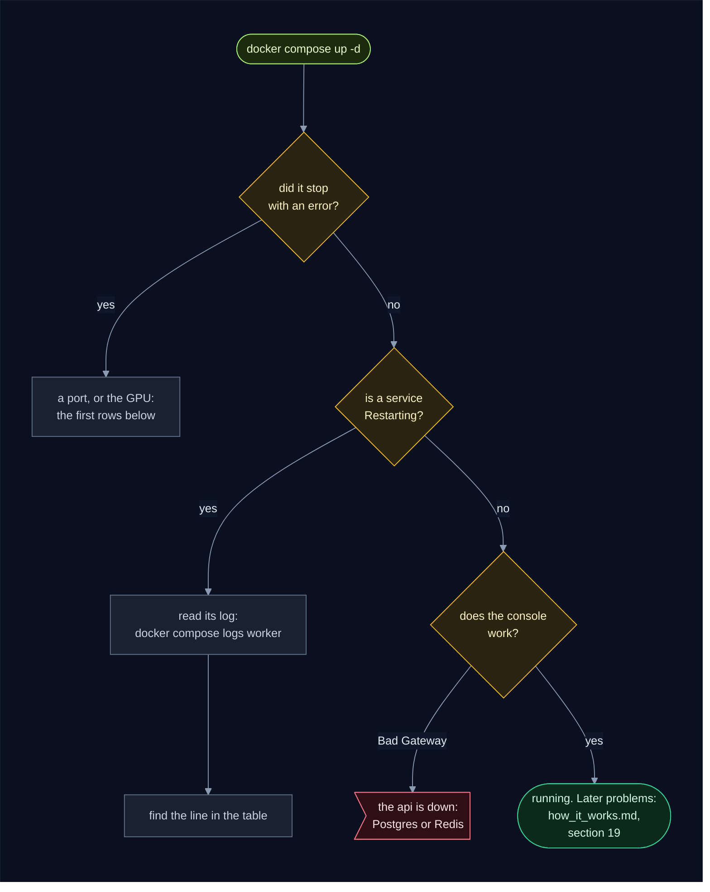

| What you see | Why | What to do |
|---|---|---|
| `docker compose up` stops with `port is already allocated` | another program has 5432, 6379, 8000 or 8080 | stop it, or give this app other ports in `.env`: `POSTGRES_PORT`, `REDIS_PORT`, `API_PORT`, `FRONTEND_PORT`. OCR's 8001 is set in `docker-compose.yml` |
| `unknown or invalid runtime name: nvidia` | Docker has no NVIDIA runtime | install it: [step 1](#1-what-you-need) |
| `ocr` keeps restarting, and its log says CUDA out of memory | something else is using the GPU | `nvidia-smi` shows what. Close it: the flags fit an 8 GB card with nothing else on it |
| `ocr` says `(health: starting)` for a long time | it's downloading or loading the model | wait, and follow `docker compose logs -f ocr` |
| the reader logs `OCR or Gemini unavailable; retrying` | OCR isn't loaded yet, or Gemini is busy | nothing: it carries on by itself |
| `worker` and `reader` keep restarting, and the log says `GEMINI_API_KEY` `Field required` | no Gemini key | put it in `.env` ([step 3](#3-put-in-your-settings)), then `docker compose up -d` |
| they stop at once: `Gemini rejected the key or model name` | a wrong key, or a model name Gemini doesn't know | fix `.env`, then `docker compose up -d` |
| the console says **Bad Gateway** | the api isn't running, most often because Postgres or Redis isn't | `docker compose ps`, then `docker compose up -d`. If the api stays `Restarting`: `docker compose up -d --force-recreate api` |
| the watcher logs `Could not connect to the endpoint URL: "http://host.docker.internal:4566/…"` | Floci isn't running | start it: [step 2](#2-start-floci-the-home-for-the-pdfs) |
| the watcher logs `NoSuchBucket` | Floci has no bucket `rci` | make it: [step 2](#2-start-floci-the-home-for-the-pdfs) |
| after a reboot, Postgres doesn't start, and the others log `failed to resolve host 'postgres'` | another project's database, which restarts by itself, took port 5432 first | stop that one, then `docker compose up -d --force-recreate postgres` |
| **snap Docker only:** containers can't reach the internet by name, ports accept a connection and then drop it, and builds fail | a snapd update (2.77.1) broke the snap Docker's AppArmor profile ([canonical/docker-snap#350](https://github.com/canonical/docker-snap/issues/350)). A reboot doesn't fix it | `sudo snap revert snapd`, then `sudo snap refresh --hold snapd` until the bug is fixed |
| a container still restarts after you've fixed the cause | Docker waits longer after each failed start | `docker compose up -d --force-recreate --no-deps worker` (with that service's name) |

Problems once it's running (a circular that fails, Gemini's quota, Redis losing its data)
are in [When things go wrong](how_it_works.md#19-when-things-go-wrong).

---

## 14. All the commands on one page

```bash
# ── The first start ──────────────────────────────────────────────────────
floci start --persist="$HOME/.floci/aws-state"                 # S3 for the PDFs, kept on disk
AWS_ACCESS_KEY_ID=test AWS_SECRET_ACCESS_KEY=test \
  aws --endpoint-url http://localhost:4566 --region us-east-1 s3 mb s3://rci   # once: the bucket
cp .env.example .env                                           # then set GEMINI_API_KEY
docker compose up -d --build                                   # everything else
xdg-open http://localhost:8080                                 # the console: create an account

# ── Is it working? ───────────────────────────────────────────────────────
docker compose ps --format "table {{.Service}}\t{{.Status}}"   # every service Up
curl localhost:8000/health                                     # {"status":"ok"}
curl -fsS localhost:8001/health && echo "OCR ready"            # the model is loaded
floci status                                                   # Reachable: yes
docker compose logs -f watcher reader worker                   # watch it work

# ── Every day ────────────────────────────────────────────────────────────
docker compose stop                                            # stop; docker compose up -d starts it again
docker compose up -d --build                                   # after editing .env or git pull
docker compose restart watcher                                 # look for new circulars now
docker compose logs reader worker | grep pipeline              # what Gemini decided

# ── Admin (in backend/api) ───────────────────────────────────────────────
uv run python manage.py companies                              # companies and their users
uv run python manage.py add-user you@company.com "Your Name" --company 1   # a login, or a new password
uv run python manage.py requeue                                # after Redis lost its data

# ── Data ─────────────────────────────────────────────────────────────────
mkdir -p backups && docker compose exec -T postgres pg_dump -U rci -d rci > backups/rci-$(date +%F).sql   # back up
docker compose down                                            # remove the containers, keep the data
docker compose down -v                                         # ⚠️ deletes the data and the model
```
