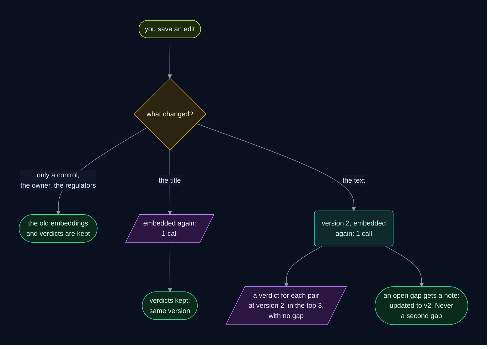
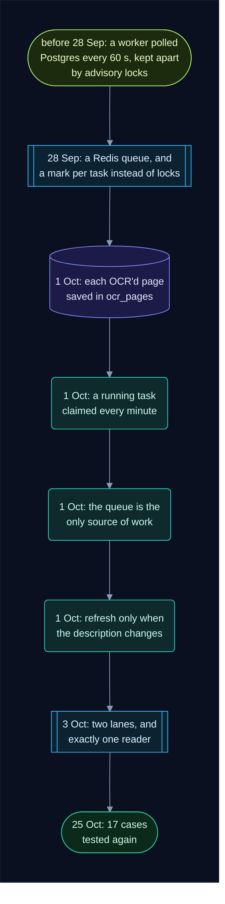

# Repeated tasks: what's done once, what's reused, and how

Reading a PDF takes minutes on the GPU, and every question to Gemini costs money and time.
So this app is built to do each piece of slow or paid work **once**, save the answer, and
reuse it. This guide answers three questions, with the tests that prove the answers:

- How many times is a newly released circular read with OCR?
- When your company adds a new policy, is any work done again, or is it all reused?
- Can a task ever run twice, and how was each way it could happen closed off?

> ✅ **The short answers.** A new circular's PDF is OCR'd **once**, page by page, for every
> company together: with 2 companies or 200, page 1 goes to the GPU one time. A new policy
> costs **one embedding call**, plus **one Gemini verdict** for each recent circular that
> applies to you where the new policy is among the 3 closest. Nothing else: no OCR, no new
> summaries, no "does it apply?", and no verdict asked twice. A task is never queued twice
> at the same time, goes to one worker only, and does nothing twice even if it's delivered
> again.

For the whole system, read [how_it_works.md](how_it_works.md); for the worker step by step,
[how_the_worker_works.md](how_the_worker_works.md).

**Reading the diagrams.** Each colour means the same thing in every diagram:

        

**Contents**

1. [Every costly piece of work, and how many times it's done](#1-every-costly-piece-of-work-and-how-many-times-its-done)
2. [The rule behind all of it](#2-the-rule-behind-all-of-it)
3. [A new circular: how many times is it OCR'd?](#3-a-new-circular-how-many-times-is-it-ocrd)
4. [Your company adds a new policy: what's reused, what's new](#4-your-company-adds-a-new-policy-whats-reused-whats-new)
5. [You edit a policy](#5-you-edit-a-policy)
6. [A company describes itself, or changes its description](#6-a-company-describes-itself-or-changes-its-description)
7. [Reprocess](#7-reprocess)
8. [Can the same task run twice?](#8-can-the-same-task-run-twice)
9. [Where work can still be repeated](#9-where-work-can-still-be-repeated)
10. [How we solved it: the history](#10-how-we-solved-it-the-history)
11. [How it was tested](#11-how-it-was-tested)
12. [Where each guard lives in the code](#12-where-each-guard-lives-in-the-code)

---

## 1. Every costly piece of work, and how many times it's done

| The work | What it costs | How many times | What makes it so |
|---|---|---|---|
| reading a PDF with OCR | minutes on the GPU | **once per PDF**, for every company; each page once; a blank page never | the read-once checks ([section 3](#3-a-new-circular-how-many-times-is-it-ocrd)) |
| summing up a circular | a Gemini call | **once per PDF** | saved in `circulars.summary`; a circular with the same PDF copies it |
| a circular's embedding (its meaning as numbers) | a Gemini embedding call | **once per circular** | saved in `circulars.embedding`, with the model's name |
| a policy's embedding | a Gemini embedding call | **once per title and text** | saved in `policies.embeddings`; cleared only when the title or the text changes |
| "does this circular apply to us?" | a Gemini call | **once per company and circular** | an `assessments` row, unique per company and circular; asked again only when the description changes, or on **Reprocess** |
| "is this policy out of date?" (a verdict) | a Gemini call | **once per circular, policy and policy version** | a `policy_checks` row, unique per circular, policy and version |
| a gap | your team's time | **at most one per circular and policy, ever** | a `gaps` row, unique per circular and policy; a pair with any gap, even a closed one, is never judged again |
| a task on the queue | a worker's time | **at most one copy** queued or running | the task's mark in Redis (`SET … NX`) |
| a task's delivery | a worker's time | **to one worker** | the Redis consumer group (`XREADGROUP`) |

---

## 2. The rule behind all of it

Every answer is **saved the moment it comes back**, and every task **looks in Postgres
first** and asks only for what's missing. A task that runs again, for whatever reason, finds
its answers already there and has nothing left to do.

Where each answer is kept:

| The answer | Its home in Postgres |
|---|---|
| each page OCR'd so far | `ocr_pages` (deleted once the whole text is saved) |
| the whole text | `circulars.text` |
| the summary, who it's for, the obligations | `circulars.summary`, `addressed_to`, `requirements` |
| the circular's embedding | `circulars.embedding`, `embedding_model` |
| a policy's embeddings | `policies.embeddings`, `embedding_model` |
| "does it apply?" and why | `assessments.applicable`, `applies_reason` |
| each verdict | `policy_checks` (circular, policy, version, out of date or not) |
| each gap | `gaps`, with its history in `gap_events` |

Redis holds only the to-do notes: which task, for which ids. The data and the answers are
always in Postgres.

---

## 3. A new circular: how many times is it OCR'd?

**Once.** Not once per company, not once per retry: once per PDF. Here is circular 98, three
pages with a blank third page, on its way in. It meets eight guards, and only a page that
gets past all of them reaches the GPU:

Each guard in plain words:

1. **The watcher saves each circular once.** Each round it asks Postgres for the ids it
   already has, one query per regulator, and skips them. If two rows for the same circular
   were ever tried, the table's unique key (`source`, `source_key`) would refuse the second.
   Only one watcher runs. The PDF is stored in S3 under its fingerprint
   (`rbi/<sha256>.pdf`), so the same file is never stored twice.
2. **One task.** Before it queues `circular.read 98`, the watcher sets a mark in Redis,
   `rci:queued:circular_id=98:type=circular.read`, with `SET … NX`: "only if it isn't there
   yet". If the mark is there, the task is already queued or running, and the copy is
   dropped. The mark is deleted when the task is finished.
3. **One reader.** The PDF lane has exactly one reader (`replicas: 1`), and the OCR server
   reads one page at a time. So two circulars with the same PDF are always read one after
   the other, never side by side. The reader also renews its claim on the task every minute,
   so no other worker takes it over while it's alive ([section 8](#8-can-the-same-task-run-twice)).
4. **Status.** Only a circular whose status is `new` is OCR'd. `parsed` means its text is
   saved, so it skips straight to the summary. `read`, `failed` and `skipped` do nothing.
   A circular published more than `LOOKBACK_DAYS` (30) days ago is marked `skipped` and
   never read.
5. **Twin.** If another circular has the same PDF (the same sha256) and its text, the text
   is copied, and so is the summary. No OCR at all.
6. **Page by page.** Each page's text is saved in `ocr_pages` the moment it comes back. A
   retry, a timeout or a new reader carries on from the next page not saved yet. Once the
   whole text is on the circular, those rows are deleted.
7. **Blank pages** (no text, images or drawings) are saved as blank and never sent.
8. **At most `OCR_MAX_PAGES`** (20) pages are read.

After the read, the reader queues **one `circular.assess` per company**. That's the
per-company part ("does it apply to us?", and your policies), and it never touches the PDF.

**Tested** (see [section 11](#11-how-it-was-tested)) by counting every page the real worker
sent to OCR:

| What happens | Pages sent to OCR | Summaries | Embedding calls |
|---|---|---|---|
| a new circular: 3 pages, page 3 blank, 2 companies | **2** (page 3 never) | 1 | 1 |
| the same `circular.read` queued twice before it runs | 2: the second `enqueue` returned `False`, so it ran once | 1 | 1 |
| the same `circular.read` delivered again after it's done | **0** | 0 | 0 |
| a second circular with exactly the same PDF | **0**: it copies the text | 0: it copies the summary | 1: its own |
| page 2's request times out | 4 requests for 3 pages: only page 2 again | 1 | 1 |
| a circular older than `LOOKBACK_DAYS` | **0**: skipped | 0 | 0 |
| the reader is killed during page 3 of 4, and another worker takes the task over | 5 requests for 4 pages: pages 1 and 2 are not sent again | 1 | 1 |

The only page ever sent twice is one whose request **never finished** (a timeout, or the
reader died mid-page): its text was never saved, so there's nothing to reuse.

---

## 4. Your company adds a new policy: what's reused, what's new

Company A (an NBFC with four RBI policies) adds **POL-AML**. Here's everything that happens,
and what each step reuses:

What the check needs, and where it comes from:

| It needs | Reused from | New work |
|---|---|---|
| the circulars' text | `circulars.text`, OCR'd when each circular arrived | none |
| their summaries and obligations | `circulars.summary`, `requirements` | none |
| the circulars' embeddings | `circulars.embedding` | none |
| which circulars apply to you | your `assessments` (done, applies) | none |
| your other policies' embeddings | `policies.embeddings` | none |
| your other policies' verdicts | `policy_checks` | none |
| **the new policy's embedding** | | **1 embedding call** (one piece per 5,000 characters, all in one call) |
| **the new policy against each recent circular where it's in the top 3** | | **1 Gemini verdict each** |

So the cost of a new policy is: **1 embedding call + (recent circulars that apply to you,
from the regulators the policy covers, where it ranks in the top 3) verdicts**. The other
policies are ranked again, but ranking is arithmetic on saved numbers: no Gemini call.

**Tested:** adding POL-AML to company A cost **1 embedding call and 3 verdicts**:
`#1 vs POL-AML v1`, `#2 vs POL-AML v1`, `#3 vs POL-AML v1`. No other pair was asked again,
and nothing was OCR'd, summed up or asked "does it apply?". Circular 4 (a cyber-security
one) wasn't asked, since POL-AML isn't among its 3 closest. The same `policy.check`
delivered again cost **nothing**.

**If you save the policy again while its check is running**, the second save's task is
dropped (its mark is still there), so two checks of one policy never run at once. Instead,
the running check sees the policy was saved after it started (`updated_at` later than when
it began) and queues itself once more, so your latest text is always checked.

---

## 5. You edit a policy

- **A new control** queues nothing: the worker reads a policy's controls each time it
  judges the policy.
- **A new title** clears the policy's embeddings, so it's embedded again (1 call). Its
  version, and so its verdicts, stay. **Tested:** POL-AML's new title cost 1 embedding
  call and nothing else.
- **A new text** is a new version. It's embedded again, and each recent circular where it
  ranks in the top 3 gets a verdict for version 2, unless the pair already has a gap. The
  version 1 verdicts stay as history. **Tested:** POL-DLP's new text cost 1 embedding call
  and 2 verdicts (`#2 vs POL-DLP v2`, `#4 vs POL-DLP v2`).

---

## 6. A company describes itself, or changes its description

| What you do | What's queued | What's asked again |
|---|---|---|
| sign up | nothing | nothing: there's nothing to judge yet |
| save the same description again | nothing | nothing |
| change only the name | nothing | nothing |
| add or change the description | one `company.refresh` | **only "does it apply?"**, for each circular read in the last 30 days |

A changed description can change which circulars apply to you, so that one question is asked
again; your earlier answers older than the change go back to pending. The OCR text, the
summaries and your verdicts are all kept. For a circular that now applies, only pairs never
judged cost a verdict.

**Tested:** company B saving the same description again cost **nothing**. Changing it cost
**4 "does it apply?" calls** (one per recent circular) and nothing else. A new company, C,
describing itself cost the same 4 calls.

If the description is changed again while its refresh is running, the refresh notices and
queues itself once more, the same way a policy check does.

---

## 7. Reprocess

**Reprocess** on a circular's page is the one button that asks for work to be done again, on
purpose. Even so, it redoes as little as it can:

| The circular | What Reprocess does | What it keeps |
|---|---|---|
| not read yet (failed, or waiting) | queues it to be read again | the text if it has one (status `parsed`), and every page already in `ocr_pages` |
| read | for **your company only**: asks "does it apply?" again, and forgets your "up to date" verdicts so they're asked again | the text, the summary, other companies' answers, your gaps, and every pair that has a gap |

**Tested:** Reprocess on circular 1 for company A cost **1 "does it apply?" and 1 verdict**
(`#1 vs POL-DRP v1`, its one "up to date" pair among the 3 closest). POL-KYC and POL-AML, which
have gaps on it, were skipped, and no gap was added.

---

## 8. Can the same task run twice?

A task is a small note on a Redis stream, such as "read circular 98" or "check policy 11 for
company 1". Here's its life, with the guard at each point where it could be doubled:

Every way a task could be doubled, and what stops it:

| How it could happen | What stops it | Tested |
|---|---|---|
| the same change is saved twice in a row (two clicks, two saves) | the mark: the second `SET … NX` fails, so the second note is never added | the second `enqueue` returned `False` |
| two workers ask for work at the same moment | the consumer group gives each note to one worker and writes its name on the pending list | |
| a PDF takes longer than 5 minutes | the reader claims its note again every minute (`XCLAIM`), so it never looks abandoned while it's alive | |
| a worker dies mid-task | its note stays on the pending list; after 5 silent minutes another worker takes it over (`XAUTOCLAIM`), or at once if its own container restarts, and carries on from what was saved | the task was taken over; pages 1 and 2 were not sent again |
| a task arrives again anyway (a re-delivery, `manage.py requeue`, or a mark that expired after a day) | every step looks in Postgres first and finds its answers there | 0 calls for a repeated read, 0 for a repeated policy check |
| two tasks reach the same verdict at the same moment (a policy check and a circular check, say) | the unique key on `policy_checks` refuses the second row; that task retries and then skips the pair | one row; the race cost one extra Gemini call |
| Redis loses its data | `manage.py requeue` queues only the work Postgres shows unfinished; what's already queued is skipped by its mark | it queued 3 refreshes, which cost nothing |
| the watcher sees a circular it already saved | it skips the ids it knows, and the unique key (`source`, `source_key`) would refuse a copy | |

A task that fails for good isn't run again by itself: the same error would most likely
happen again. A person fixes the cause, then presses **Reprocess** or saves again.

---

## 9. Where work can still be repeated

Nothing is perfect. Here is every case where some work is done again, and whether it's
meant to be:

| Case | What's repeated | Meant to be? |
|---|---|---|
| a page's OCR request times out, or the reader dies mid-page | that one page is sent again | yes: its text was never saved |
| **a second circular with exactly the same PDF** (a regulator lists the same file twice, or publishes a corrigendum with the same file) | it reuses the OCR text and the summary, but gets its own embedding (1 call), its own "does it apply?" for each company and its own verdicts, so it can open its own gap for the same policy | **not ideal.** In the test it cost 1 embedding, 2 "does it apply?" calls, 3 verdicts and 1 more gap. It could copy its twin's answers instead |
| two tasks reach the same verdict at the same moment | one extra Gemini call; the second row is refused | rare, and harmless: no duplicate row or gap |
| `GEMINI_EMBEDDING_MODEL_NAME` changes | every circular and policy is embedded again once, the next time it's used | yes: numbers from two models can't be compared |
| a company changes its description | "does it apply?" for every recent circular | yes: the answers may change |
| **Reprocess** | "does it apply?" and the "up to date" verdicts, for your company | yes: that's what it's for |
| Gemini or OCR answers with an error (a 5xx, a timeout, a 429) | LangChain retries the request up to 3 times, then the worker retries the task up to 3 times | yes: only the failed request is repeated, never a finished answer |

---

## 10. How we solved it: the history

The app didn't start like this. Each guard was added when we found a way work could repeat:

| When | What could repeat, or how it was handled before | The fix | Commit |
|---|---|---|---|
| until 2026-09-28 | A single worker **polled Postgres every 60 seconds** for work. To run several, `locks.py` took Postgres advisory locks (one for the policy library, one for the GPU, one per circular), and a worker skipped anything locked. | | `a22e02f` |
| 2026-09-28 | Polling found work late, and the locks were a second system to get right. | A **Redis Streams task queue**: every change queues its task, and the consumer group gives each task to one worker. | `434b06a` |
| 2026-09-28 | With a queue, the same work could be queued twice (two saves in a row). The locks were still there. | A **mark per task** (`SET … NX`, deleted when the task is done) replaced the locks: once `XREADGROUP` gives each task to one worker, "skip whatever is locked" has nothing left to do. | `29089bd` |
| 2026-10-01 | Pages already OCR'd were kept **in the worker's memory**. A restarted worker lost them and read every page again. | Each page is **saved in `ocr_pages`** the moment it's read; any worker carries on from there. | `31e3843` |
| 2026-10-01 | A task silent for **30 minutes** was taken over, even if its worker was still reading a long PDF, so the PDF could be read twice. A dead worker's task also waited 30 minutes. | The running worker **claims its task again every minute**; only a task silent for 5 minutes is taken over. | `65f7956` |
| 2026-10-01 | Every 15 minutes a **reconciler** scanned Postgres and queued unfinished work again, on top of the queue: two ways for the same work to arrive. | The queue is the **only source of work**. After Redis loses its data, `manage.py requeue` is run once, by hand. | `f964ed6` |
| 2026-10-01 | **Every company save**, a sign-up or a name change included, queued a `company.refresh`. | Only a description **added or changed** queues it. | `c0fac83` |
| 2026-10-03 | A 2-second check waited 6 minutes behind three PDF reads, all on one queue. | **Two lanes**: PDFs on their own, everything else on the main lane. | `5fdacde` |
| 2026-10-03 | `READERS` allowed more than one reader. Two circulars with the same new PDF could then be OCR'd **at the same time**, because a twin only sees text that's already saved. | **Exactly one reader**, always. | `2349763` |
| 2026-10-25 | | 17 cases tested again against the real worker ([section 11](#11-how-it-was-tested)). | |

---

## 11. How it was tested

On 2026-10-25 these 17 scenarios were run through the **real worker loop**
(`main.serve`: `XREADGROUP`, the task functions, the marks, `XACK`) against a scratch Postgres
and a scratch Redis, never the live ones. The tasks were produced the way the watcher and the
api produce them: the row first, then `queue.enqueue`. Only the OCR server and Gemini were
replaced, by stand-ins that count every call. The world: company A (an NBFC, policies
POL-KYC, POL-DRP, POL-DLP and POL-IT), company B (a stock broker), RBI circulars.

| # | Scenario | OCR pages sent | Summaries | Embedding calls | "Does it apply?" | Verdicts | New gaps |
|---|---|---|---|---|---|---|---|
| 1 | a new circular (3 pages, page 3 blank), 2 companies | 2 | 1 | 1 | 2 | 3 | 1 |
| 2 | the same `circular.read` queued twice before it runs | 2 (ran once) | 1 | 1 | 2 | 3 | 0 |
| 3 | the same `circular.read` delivered again after it's done | 0 | 0 | 0 | 0 | 0 | 0 |
| 4 | a new circular with the same PDF as #1 | 0 | 0 | 1 | 2 | 3 | 1 |
| 5 | page 2's OCR request times out | 4 (3 pages) | 1 | 1 | 2 | 3 | 1 |
| 6 | a circular older than `LOOKBACK_DAYS` | 0 | 0 | 0 | 0 | 0 | 0 |
| 7 | company A adds POL-AML | 0 | 0 | 1 | 0 | 3 | 2 |
| 8 | the same `policy.check` delivered again | 0 | 0 | 0 | 0 | 0 | 0 |
| 9 | POL-AML's title changes | 0 | 0 | 1 | 0 | 0 | 0 |
| 10 | POL-DLP's text changes (version 2) | 0 | 0 | 1 | 0 | 2 | 0 |
| 11 | company B saves the same description again | 0 | 0 | 0 | 0 | 0 | 0 |
| 12 | company B changes its description | 0 | 0 | 0 | 4 | 0 | 0 |
| 13 | a new company C describes itself | 0 | 0 | 0 | 4 | 0 | 0 |
| 14 | Reprocess circular 1 for company A | 0 | 0 | 0 | 1 | 1 | 0 |
| 15 | two workers judge #1 vs POL-DRP at the same moment | 0 | 0 | 0 | 0 | 1 extra | 0 (one row) |
| 16 | the reader is killed during page 3 of 4; another worker takes the task over | 5 (4 pages) | 1 | 1 | 3 (3 companies by then) | 3 | 0 |
| 17 | Redis loses all its data; `manage.py requeue` (3 unfinished refreshes queued) | 0 | 0 | 0 | 0 | 0 | 0 |

At the end: no tasks pending on either lane, no marks left in Redis, no rows left in
`ocr_pages`, and every circular `read` except the old one (`skipped`).

To run such a test yourself, start a scratch Postgres and Redis on other ports, point the
worker's `DATABASE_URL` and `REDIS_URL` at them, replace `ocr.ocr_page` and the four Gemini
calls in `llm.py` with counters, and run `main.serve(r, name, lane, once=True)` for each lane
until both are empty.

---

## 12. Where each guard lives in the code

| Guard | Where |
|---|---|
| skip circulars already saved; one PDF file per fingerprint | `run_source()`, `fetch_new()` in `backend/watcher/main.py` |
| unique keys: circular, assessment, verdict, gap | `backend/common/common/models.py` (`UniqueConstraint`) |
| a mark per task, deleted when the task is done | `enqueue()`, `key()` in `backend/common/common/queue.py`; `run_task()` in `backend/worker/main.py` |
| one worker per task; retries first, then left-behind tasks, then new ones | `next_task()` in `backend/worker/main.py` |
| claim the running task every minute | `keep_claimed()` in `backend/worker/main.py` |
| exactly one reader | `reader: deploy: replicas: 1` in `docker-compose.yml` |
| read only new circulars; skip old ones; reuse a twin's text and summary | `read_circular()`, `twin()` in `backend/worker/pipeline.py` |
| page by page, saved as it's read; blank pages never sent | `ocr_text()` in `pipeline.py`; `pages()`, `blank()` in `backend/worker/ocr.py` |
| embed once per model, and again only when the text or title changes | `embed_circular()`, `embed_policy()` in `pipeline.py`; `update_policy()` in `backend/api/routes/policies.py` |
| ask "does it apply?" once | `assess()`, `add_assessments()` in `pipeline.py` |
| skip pairs judged at this version, or with a gap | `match()` in `pipeline.py` |
| a check or refresh queues itself again if its subject changed meanwhile | `check_policy()`, `refresh_company()` in `pipeline.py` |
| only a changed description queues a refresh | `set_company()` in `backend/api/routes/company.py` |
| Reprocess redoes only your company's answers | `reprocess_circular()` in `backend/api/routes/circulars.py` |
| requeue only unfinished work | `requeue()` in `backend/api/manage.py` |
| what's retried, waited for, or given up | `backend/worker/failures.py` |
