# Repeated tasks: what's done once, what's reused, and how

Reading a PDF takes minutes on the GPU, and every question to Gemini costs money and time.
So this app is built to do each piece of slow or paid work **once**, save the answer, and
reuse it. This guide answers three questions, with the tests that prove the answers:

- How many times is a newly released circular read with OCR?
- When your company adds a new policy, is any work done again, or is it all reused?
- Can a task ever run twice, and how was each way it could happen closed off?

> ✅ **The short answers.** A new circular's PDF is OCR'd **once**, page by page, for every
> company together: with 2 companies or 200, page 1 goes to the GPU one time. A new policy
> costs **one embedding call**, plus **one Gemini verdict** for each recent circular that
> applies to you where the new policy is among the 3 closest. Nothing else: no OCR, no new
> summaries, no "does it apply?", and no verdict asked twice. A task is never queued twice
> at the same time, goes to one worker only, and does nothing twice even if it's delivered
> again.

> 🧰 **New to Redis?** [Section 3](#3-redis-from-zero) explains every Redis word this guide
> uses (a key, a mark, `SET … NX`, a lane, the group, the pending list, `XADD`, `XREADGROUP`,
> `XACK`, `XCLAIM`, `XAUTOCLAIM`) from zero, with a diagram for each and Redis's real answers.

For the whole system, read [how_it_works.md](how_it_works.md); for the worker step by step,
[how_the_worker_works.md](how_the_worker_works.md).

**Reading the diagrams.** Each colour means the same thing in every diagram:

        

**Contents**

1. [Every costly piece of work, and how many times it's done](#1-every-costly-piece-of-work-and-how-many-times-its-done)
2. [The rule behind all of it](#2-the-rule-behind-all-of-it)
3. [Redis, from zero: marks, lanes and the commands](#3-redis-from-zero)
4. [A new circular: how many times is it OCR'd?](#4-a-new-circular-how-many-times-is-it-ocrd)
5. [Your company adds a new policy: what's reused, what's new](#5-your-company-adds-a-new-policy-whats-reused-whats-new)
6. [You edit a policy](#6-you-edit-a-policy)
7. [A company describes itself, or changes its description](#7-a-company-describes-itself-or-changes-its-description)
8. [Reprocess](#8-reprocess)
9. [Can the same task run twice?](#9-can-the-same-task-run-twice)
10. [Where work can still be repeated](#10-where-work-can-still-be-repeated)
11. [How we solved it: the history](#11-how-we-solved-it-the-history)
12. [How it was tested](#12-how-it-was-tested)
13. [Where each guard lives in the code](#13-where-each-guard-lives-in-the-code)

---

## 1. Every costly piece of work, and how many times it's done

| The work | What it costs | How many times | What makes it so |
|---|---|---|---|
| reading a PDF with OCR | minutes on the GPU | **once per PDF**, for every company; each page once; a blank page never | the read-once checks ([section 4](#4-a-new-circular-how-many-times-is-it-ocrd)) |
| summing up a circular | a Gemini call | **once per PDF** | saved in `circulars.summary`; a circular with the same PDF copies it |
| a circular's embedding (its meaning as numbers) | a Gemini embedding call | **once per circular** | saved in `circulars.embedding`, with the model's name |
| a policy's embedding | a Gemini embedding call | **once per title and text** | saved in `policies.embeddings`; cleared only when the title or the text changes |
| "does this circular apply to us?" | a Gemini call | **once per company and circular** | an `assessments` row, unique per company and circular; asked again only when the description changes, or on **Reprocess** |
| "is this policy out of date?" (a verdict) | a Gemini call | **once per circular, policy and policy version** | a `policy_checks` row, unique per circular, policy and version |
| a gap | your team's time | **at most one per circular and policy, ever** | a `gaps` row, unique per circular and policy; a pair with any gap, even a closed one, is never judged again |
| a task on the queue | a worker's time | **at most one copy** queued or running | the task's mark in Redis, pinned with `SET … NX` ([the mark](#the-mark-a-key-that-says-a-task-is-waiting)) |
| a task's delivery | a worker's time | **to one worker** | the lane's group hands each note to one worker, `XREADGROUP` ([how](#xreadgroup-a-worker-takes-a-note)) |

---

## 2. The rule behind all of it

Every answer is **saved the moment it comes back**, and every task **looks in Postgres
first** and asks only for what's missing. A task that runs again, for whatever reason, finds
its answers already there and has nothing left to do.

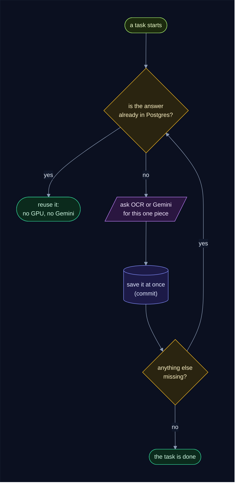

Where each answer is kept:

| The answer | Its home in Postgres |
|---|---|
| each page OCR'd so far | `ocr_pages` (deleted once the whole text is saved) |
| the whole text | `circulars.text` |
| the summary, who it's for, the obligations | `circulars.summary`, `addressed_to`, `requirements` |
| the circular's embedding | `circulars.embedding`, `embedding_model` |
| a policy's embeddings | `policies.embeddings`, `embedding_model` |
| "does it apply?" and why | `assessments.applicable`, `applies_reason` |
| each verdict | `policy_checks` (circular, policy, version, out of date or not) |
| each gap | `gaps`, with its history in `gap_events` |

Redis holds only the to-do notes: which task, for which ids. The data and the answers are
always in Postgres. The next section explains Redis from zero.

---

## 3. Redis, from zero

Redis is the second place this app keeps things, after Postgres. The rest of this guide
talks about marks, lanes, `SET … NX`, `XADD`, `XREADGROUP`, `XACK`, `XCLAIM` and
`XAUTOCLAIM`. This section explains each of them from the beginning, with the real commands
the app sends and Redis's real answers, recorded on 2026-10-25 with `redis-cli` on Redis 7,
the version the app runs.

### What Redis is, here

Redis is a small database that keeps everything in memory, so each command takes well under a
millisecond. Think of it as the office's **notice board**: every part of the app can pin
things to it and read them. This app pins only two kinds of thing there:

- **Marks**: small named notes that say "this task is already waiting".
- **Lanes**: to-do lists of tasks, in the order they were added.

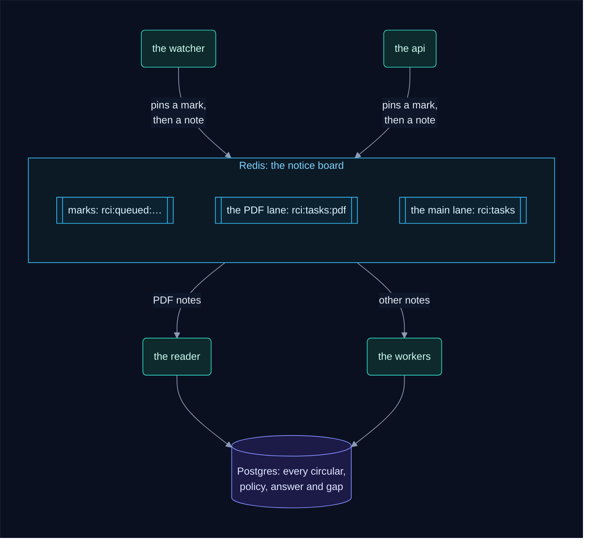

A note on a lane holds only names and numbers, such as "read circular 98". The circular itself,
its text and every answer are in Postgres, where the worker looks them up. Redis writes its
data to disk as it goes (`--appendonly yes` in `docker-compose.yml`), so a restart loses
nothing.

### A key: a named note

In Redis everything is stored under a name, called a **key**, and a key holds a **value**.
Picture a sticky note: its name written on top, something written under it. Five commands
are all this guide needs for keys:

| Command | What it does |
|---|---|
| `SET name value` | write a key |
| `GET name` | read it |
| `EXISTS name` | is there a key with this name? 1 for yes, 0 for no |
| `TTL name` | how many seconds until it deletes itself |
| `DEL name` | delete it |

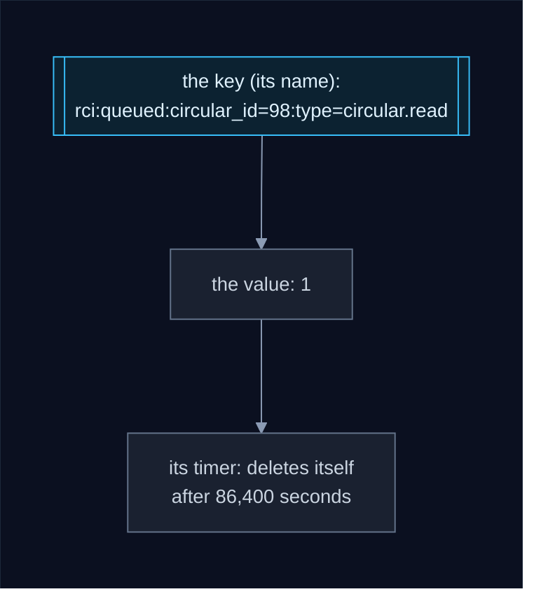

### The mark: a key that says a task is waiting

Before any part of the app puts a task on a lane, it writes a **mark**: a key whose name says
exactly which task it is. For "read circular 98" the mark is:

```
rci:queued:circular_id=98:type=circular.read
```

Piece by piece:

| Piece | What it means |
|---|---|
| `rci:` | this app's keys all start with `rci` (Regulatory Circular Impact), so they never mix with another app's |
| `queued:` | what kind of key it is: a mark for a queued task |
| `circular_id=98` | the task is about circular 98 |
| `type=circular.read` | the task itself: read its PDF |

The parts after `queued:` are the task's own fields, sorted by name, so the same task always
gets exactly the same mark. The other tasks' marks look like this:

| Task | Its mark |
|---|---|
| check circular 98 for company 1 | `rci:queued:circular_id=98:company_id=1:type=circular.assess` |
| check policy 11 of company 1 | `rci:queued:company_id=1:policy_id=11:type=policy.check` |
| company 1's description changed | `rci:queued:company_id=1:type=company.refresh` |

The value is just `1`: only the name matters. **While the mark exists, the task counts as
queued or running**, and nobody adds it again.

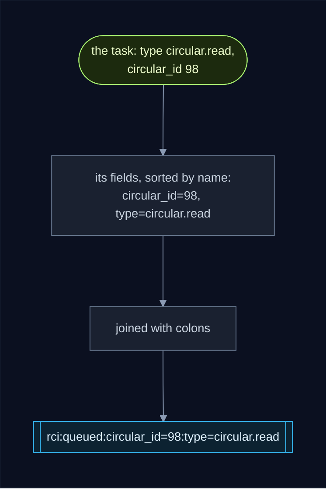

In the code: `key()` in `backend/common/common/queue.py`.

### SET with NX and EX: write it only if it isn't there

This is the command that writes the mark:

```
SET rci:queued:circular_id=98:type=circular.read 1 NX EX 86400
```

| Piece | What it means |
|---|---|
| `SET` | write a key |
| `rci:queued:circular_id=98:type=circular.read` | the key's name: the mark |
| `1` | its value (only the name matters) |
| `NX` | **N**ot e**X**ists: write it only if there's no key with this name yet. If there is one, write nothing |
| `EX 86400` | **EX**pire: delete it by itself after 86,400 seconds, which is one day |

So the whole line says: *"pin a note named rci:queued:circular_id=98:type=circular.read, but
only if no note with that name is there yet, and take it down after a day."*

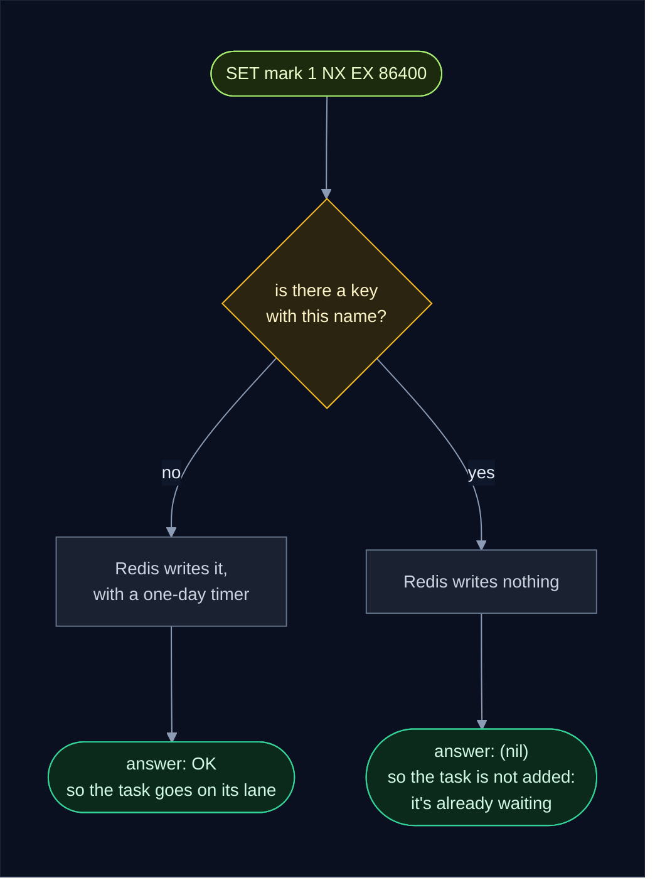

The real answers:

```
> SET rci:queued:circular_id=98:type=circular.read 1 NX EX 86400
OK
> SET rci:queued:circular_id=98:type=circular.read 1 NX EX 86400
(nil)
> EXISTS rci:queued:circular_id=98:type=circular.read
(integer) 1
> TTL rci:queued:circular_id=98:type=circular.read
(integer) 86399
```

- The first `SET` answers **OK**: the mark was written, so the watcher goes on to put the task
  on the PDF lane.
- The second, the same command again, answers **(nil)**, which means "nothing". The mark was
  already there, so nothing was written and the task is not added a second time. In Python,
  `client.set(…, nx=True, ex=86400)` returns `None`, and `enqueue()` returns `False`.
- `EXISTS` answers 1: the mark is there.
- `TTL` answers 86399: 86,399 seconds, one second short of a day, until it deletes itself.

In the code: `enqueue()` in `backend/common/common/queue.py`.

### Two saves at the same moment

Redis runs **one command at a time**, from every client, one after the other. So even when two
saves arrive at the very same moment, their two `SET … NX` commands still run one after the
other: the first writes the mark, and the second finds it. Exactly one of them wins.

```mermaid
%%{init: {"theme": "base", "sequence": {"diagramMarginX": 0, "diagramMarginY": 0}, "themeVariables": {"darkMode": true, "primaryColor": "#16213a", "primaryTextColor": "#e6edf7", "primaryBorderColor": "#475a7a", "lineColor": "#8b9bb4", "secondaryColor": "#1b2436", "tertiaryColor": "#101a2e", "edgeLabelBackground": "#0f172a", "textColor": "#e2e8f0", "actorBkg": "#16213a", "actorBorder": "#5eead4", "actorTextColor": "#e6edf7", "actorLineColor": "#3b4a66", "signalColor": "#8b9bb4", "signalTextColor": "#e2e8f0", "noteBkgColor": "#2a2410", "noteBorderColor": "#fbbf24", "noteTextColor": "#fde68a", "labelBoxBkgColor": "#1e293b", "labelBoxBorderColor": "#64748b", "labelTextColor": "#e2e8f0", "loopTextColor": "#c4b5fd", "sequenceNumberColor": "#0b1020", "activationBkgColor": "#1e293b"}}}%%
sequenceDiagram
    autonumber
    box rgb(11, 16, 32)
        participant S1 as save 1 (api)
        participant R as Redis
        participant S2 as save 2 (api)
    end

    rect rgb(13, 20, 36)
        Note right of S1: two saves of POL-AML,<br/>a moment apart
        S1->>R: SET …policy_id=11… 1 NX EX 86400
        S2->>R: SET …policy_id=11… 1 NX EX 86400
        R-->>S1: OK: the mark is yours
        R-->>S2: (nil): it's there already
        S1->>R: XADD rci:tasks: policy.check 11
        Note left of S2: adds nothing: the check<br/>already queued reads<br/>the latest text
    end
```

### When a mark goes away: DEL, or a day later

A mark lives from the moment its task is queued until the task is **finished**. Then the worker
deletes it with `DEL`, so the same task can be queued again some day (by **Reprocess**, say).

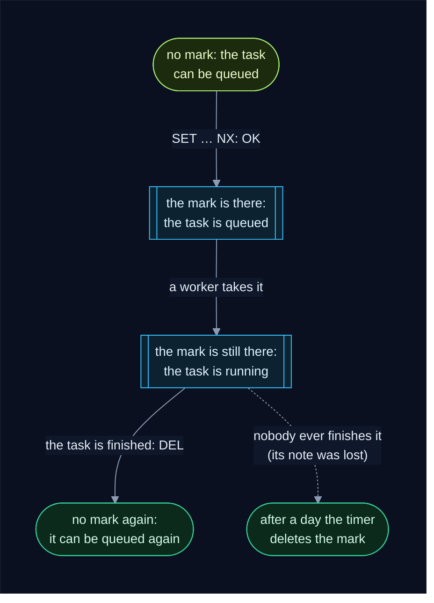

```
> DEL rci:queued:circular_id=98:type=circular.read
(integer) 1
> EXISTS rci:queued:circular_id=98:type=circular.read
(integer) 0
> SET rci:queued:circular_id=98:type=circular.read 1 NX EX 86400
OK
```

`DEL` answers how many keys it deleted: 1. After it, `EXISTS` says 0, and a new `SET … NX`
answers OK again. **The one-day timer is a safety net.** If a task's note were ever lost
(Redis's data deleted, say), its mark couldn't block that task forever: after a day it's gone.

### A lane: a Redis stream

A lane is a Redis **stream**: a list of notes kept in the order they were added, like a ticket
roll at a counter. New notes go on the end; each note keeps its place. The app has two lanes:

| Lane | Its key | The notes on it | Taken by |
|---|---|---|---|
| the PDF lane | `rci:tasks:pdf` | `circular.read` (minutes each, on the GPU) | the one reader |
| the main lane | `rci:tasks` | `circular.assess`, `policy.check`, `company.refresh` (seconds each) | the workers |

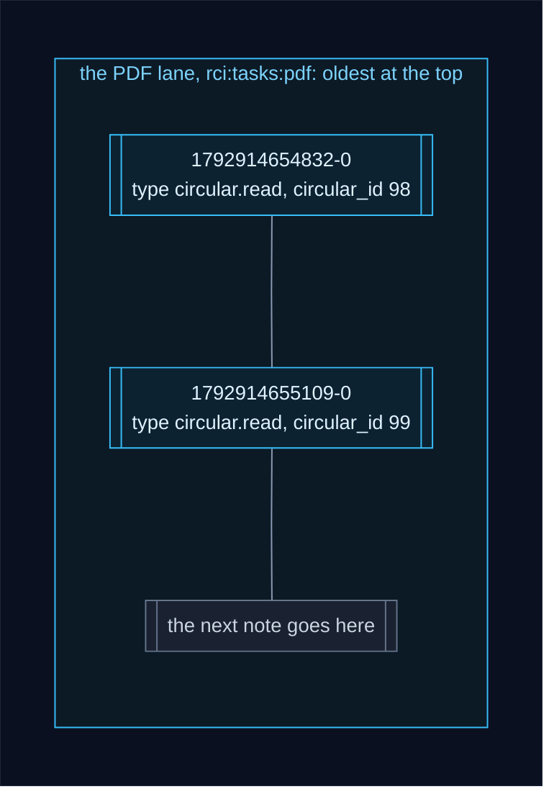

Each note (Redis calls it an **entry**) gets an id from Redis, such as `1792914654832-0`: the
moment it was added, in milliseconds since 1 January 1970, then a dash and a counter for notes
added in the same millisecond. A note holds **fields**, name and value pairs: here `type
circular.read` and `circular_id 98`.

### XADD: a note on the lane

```
XADD rci:tasks:pdf MAXLEN ~ 100000 * type circular.read circular_id 98
```

| Piece | What it means |
|---|---|
| `XADD` | add a note to the end of a stream (X is the letter of every stream command) |
| `rci:tasks:pdf` | which stream: the PDF lane |
| `MAXLEN ~ 100000` | keep only about the newest 100,000 notes, dropping older ones, so the lane never fills the memory. `~` means "about", which lets Redis trim in cheap chunks |
| `*` | let Redis give the note its id |
| `type circular.read` | a field: what to do |
| `circular_id 98` | a field: which circular |

```
> XADD rci:tasks:pdf MAXLEN ~ 100000 * type circular.read circular_id 98
"1792914654832-0"
> XLEN rci:tasks:pdf
(integer) 1
> XRANGE rci:tasks:pdf - +
1) 1) "1792914654832-0"
   2) 1) "type"
      2) "circular.read"
      3) "circular_id"
      4) "98"
```

`XADD` answers with the new note's id. `XLEN` counts the notes on the lane. `XRANGE - +` lists
them from the first (`-`) to the last (`+`): each note's id, then its fields.

The mark always comes **first**, then the note. If Redis can't take the note, the mark is
deleted again and the error is passed on: the watcher then keeps nothing about the circular
(the next round tries again), and the api answers "try again". No task is ever lost quietly.

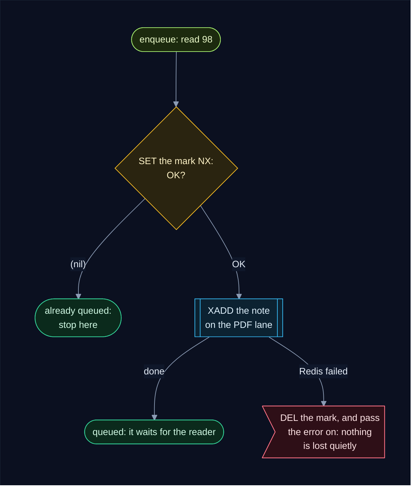

In the code: `enqueue()` in `backend/common/common/queue.py`.

### The group and its pending list

Several workers share one lane, like a team sharing one to-do list. Redis calls the team a
**consumer group**; this app's is named `workers`. Each worker is a **consumer** with a name:
its container's id, a dash, its process number, such as `e02ff2af94f5-1`.

The group remembers two things:

- **how far down the lane it has handed notes out** (a bookmark);
- the **pending list**: every note handed out but not finished yet, with **who** has it, how
  long it's been **idle** (untouched), and how many times it's been **delivered** (handed out).

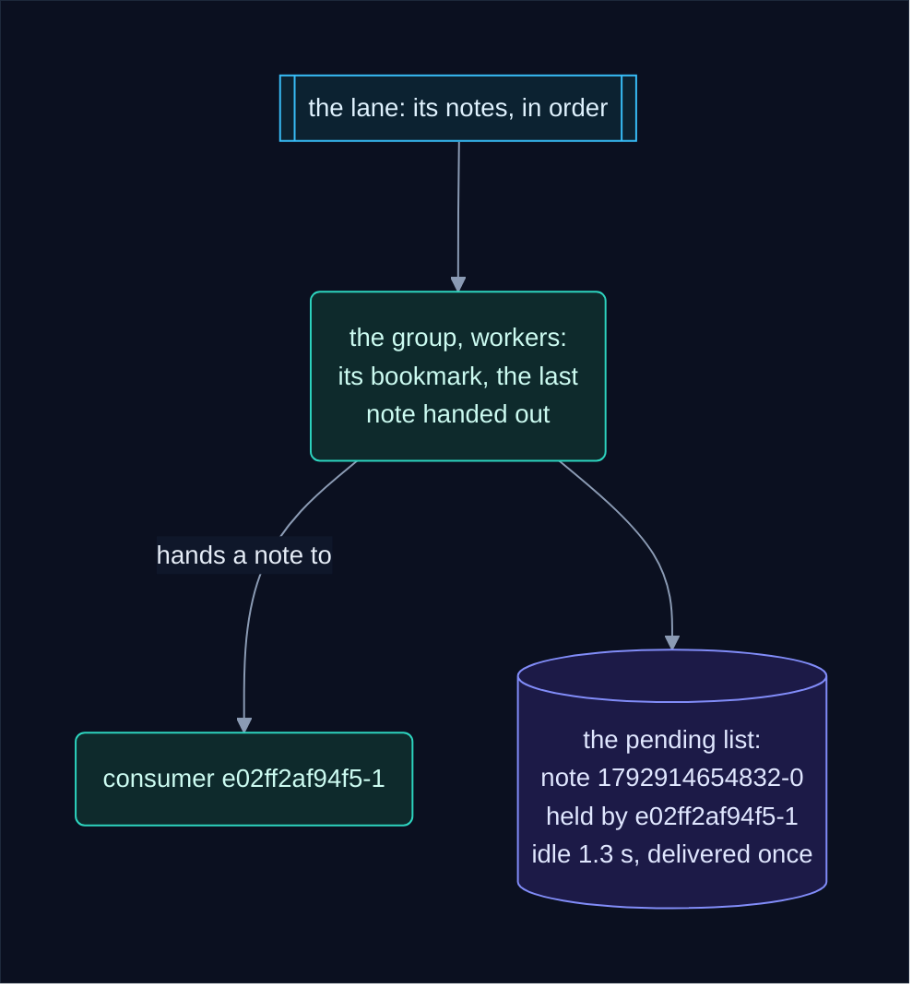

The group is made once per lane:

```
> XGROUP CREATE rci:tasks:pdf workers 0 MKSTREAM
OK
```

That says: make the group `workers` on the PDF lane, starting from the very first note (`0`),
and make the lane too if it doesn't exist (`MKSTREAM`). A worker sends it each time before it
asks for a task, so a lane lost with Redis's data comes back by itself. When the group already
exists, Redis answers `BUSYGROUP`, and the worker simply carries on.

### XREADGROUP: a worker takes a note

```
XREADGROUP GROUP workers e02ff2af94f5-1 COUNT 1 BLOCK 5000 STREAMS rci:tasks:pdf >
```

| Piece | What it means |
|---|---|
| `XREADGROUP` | read notes as a member of a group: each note goes to one member only |
| `GROUP workers` | the group |
| `e02ff2af94f5-1` | who is asking: the reader |
| `COUNT 1` | one note at a time |
| `BLOCK 5000` | if there's none, wait up to 5,000 ms (5 seconds) for one to arrive |
| `STREAMS rci:tasks:pdf` | from the PDF lane |
| `>` | only notes never handed to anyone yet |

```
> XREADGROUP GROUP workers e02ff2af94f5-1 COUNT 1 BLOCK 5000 STREAMS rci:tasks:pdf >
1) 1) "rci:tasks:pdf"
   2) 1) 1) "1792914654832-0"
         2) 1) "type"
            2) "circular.read"
            3) "circular_id"
            4) "98"
> XPENDING rci:tasks:pdf workers - + 10
1) 1) "1792914654832-0"
   2) "e02ff2af94f5-1"
   3) (integer) 1300
   4) (integer) 1
> XREADGROUP GROUP workers c9f550b306ee-1 COUNT 1 STREAMS rci:tasks:pdf >
(nil)
```

- The reader gets the note: the lane's name, then the note's id and fields.
- `XPENDING` shows the pending list: the note, **who has it** (`e02ff2af94f5-1`), idle for
  **1,300 ms**, delivered **1** time.
- A second worker, `c9f550b306ee-1`, asks for a new note and gets **(nil)**, nothing: the only
  note is already handed out. **This is why two workers never get the same task.**

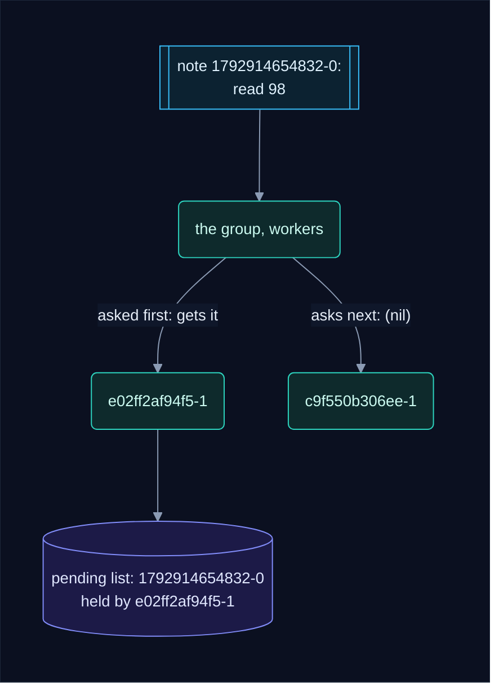

In the code: `next_task()` in `backend/worker/main.py`.

### XACK: ticked off

When a task is done, the worker **acknowledges** its note: "finished, take it off my list".

```
> XACK rci:tasks:pdf workers 1792914654832-0
(integer) 1
> XACK rci:tasks:pdf workers 1792914654832-0
(integer) 0
> XPENDING rci:tasks:pdf workers
1) (integer) 0
2) (nil)
3) (nil)
4) (nil)
> XLEN rci:tasks:pdf
(integer) 1
```

- `XACK` answers **1**: one note left the pending list.
- Sent again it answers **0**: it was already off. Acknowledging twice does no harm.
- `XPENDING` now shows **0** pending.
- `XLEN` still shows **1**: the note stays on the lane as history (until `MAXLEN` trims it),
  but it's never handed out again.

A task ends in this order, and the order matters:

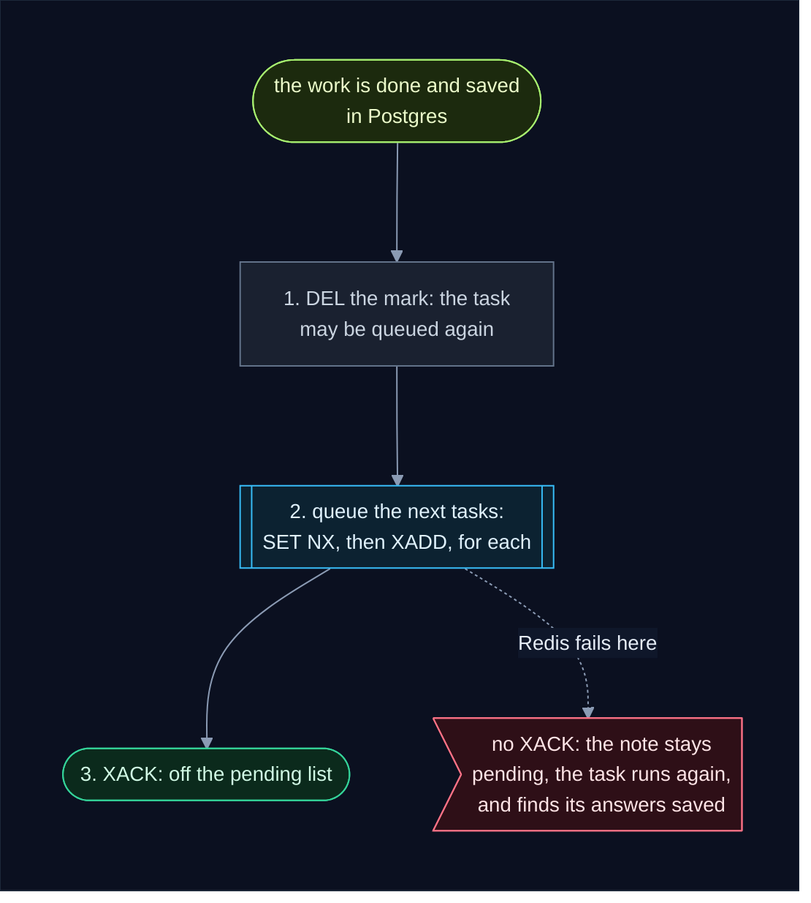

The note is acknowledged **last**. If anything goes wrong before that, the note is still on
the pending list, so the task runs again, finds its work already saved in Postgres, and only
finishes off what's missing. Nothing is lost, and nothing is done twice.

In the code: `run_task()` in `backend/worker/main.py`.

### XCLAIM: still mine

A PDF can take many minutes. So that its note never looks abandoned, the reader **claims it
again every minute** while it works: a heartbeat that says "still mine, still working".

```
XCLAIM rci:tasks:pdf workers e02ff2af94f5-1 0 1792914654832-0 JUSTID
```

| Piece | What it means |
|---|---|
| `XCLAIM` | claim a pending note for a member |
| `rci:tasks:pdf`, `workers` | the lane and the group |
| `e02ff2af94f5-1` | the member: the reader itself |
| `0` | claim it however recently it was touched |
| `1792914654832-0` | the note |
| `JUSTID` | answer with just the id; this doesn't count as another delivery |

```
> XPENDING rci:tasks:pdf workers - + 10
1) 1) "1792914654832-0"
   2) "e02ff2af94f5-1"
   3) (integer) 1300
   4) (integer) 1
> XCLAIM rci:tasks:pdf workers e02ff2af94f5-1 0 1792914654832-0 JUSTID
1) "1792914654832-0"
> XPENDING rci:tasks:pdf workers - + 10
1) 1) "1792914654832-0"
   2) "e02ff2af94f5-1"
   3) (integer) 444
   4) (integer) 1
```

The idle time went from **1,300 ms back down** (444 ms had passed by the next look): claiming
its own note **resets its idle clock**. The delivery count stays at 1. Since the reader does
this every 60 seconds, its note is never idle for more than about a minute.

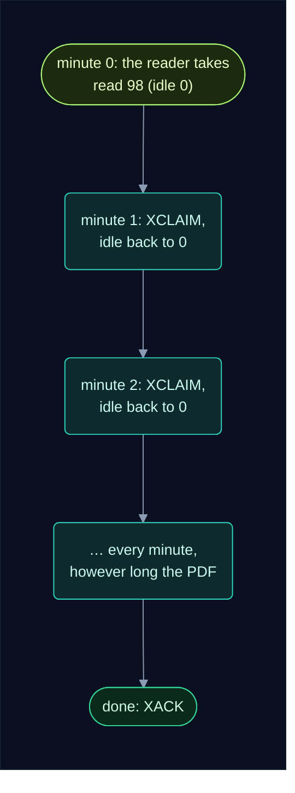

In the code: `keep_claimed()` in `backend/worker/main.py`.

### XAUTOCLAIM: taking over from a silent worker

If a worker dies mid-task, it stops claiming its note, and the note's idle time grows. Another
worker looks for such notes with `XAUTOCLAIM` and takes over any that's been **silent for 5
minutes**.

```
XAUTOCLAIM rci:tasks:pdf workers c9f550b306ee-1 300000 0-0 COUNT 1
```

| Piece | What it means |
|---|---|
| `XAUTOCLAIM` | find left-behind notes on the pending list, and take them over |
| `rci:tasks:pdf`, `workers` | the lane and the group |
| `c9f550b306ee-1` | who takes them: a new reader |
| `300000` | only notes idle at least 300,000 ms: 5 minutes |
| `0-0` | look from the start of the pending list |
| `COUNT 1` | at most one |

While the first reader is alive (its note is never idle for long), the answer is "nothing":

```
> XAUTOCLAIM rci:tasks:pdf workers c9f550b306ee-1 300000 0-0 COUNT 1
1) "0-0"
2) (empty array)
3) (empty array)
```

If it died, five minutes later the same command takes the note over. To show that without
waiting five minutes, here it is with `0` instead of `300000`:

```
> XAUTOCLAIM rci:tasks:pdf workers c9f550b306ee-1 0 0-0 COUNT 1
1) "0-0"
2) 1) 1) "1792914677467-0"
      2) 1) "type"
         2) "circular.read"
         3) "circular_id"
         4) "98"
3) (empty array)
> XPENDING rci:tasks:pdf workers - + 10
1) 1) "1792914677467-0"
   2) "c9f550b306ee-1"
   3) (integer) 443
   4) (integer) 2
```

The new reader got the note, and the pending list now says **c9f550b306ee-1** has it,
**delivered 2** times. It then runs the task, which carries on from what the first reader
saved: the pages already OCR'd are not sent again.

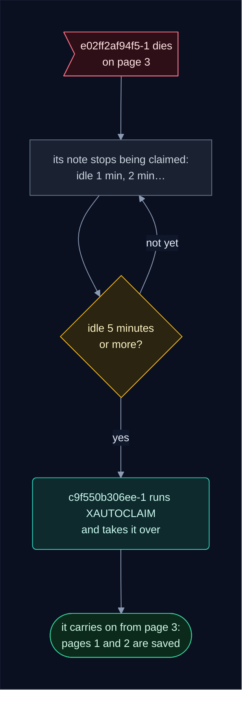

If the dead reader's own container restarts instead, it comes back with the same name and finds
its note at once (next part).

### Where a worker looks for its next note

Each time a worker is free, it asks three questions, in this order:

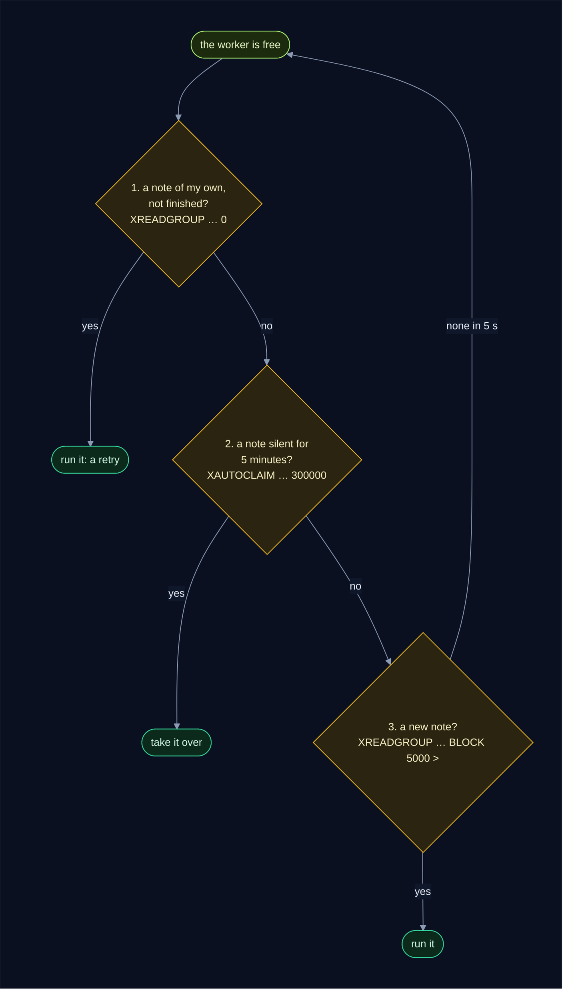

1. **Its own unfinished notes** first: `XREADGROUP … STREAMS rci:tasks:pdf 0`. The `0` (instead
   of `>`) means "notes already handed to me". When there are none, the answer is an empty
   list: `1) "rci:tasks:pdf"`, `2) (empty array)`. A task that hit a hiccup is retried this way.
2. **A note left behind** by a dead worker: `XAUTOCLAIM`, as above.
3. **A new note**: `XREADGROUP … BLOCK 5000 … >`. If none arrives in 5 seconds, it asks all
   three again.

In the code: `next_task()` in `backend/worker/main.py`.

### rci:dead: the tasks given up

When a task fails for good (an error that waiting or retrying won't fix), the worker copies it,
with the error, to one more stream, `rci:dead`, and then finishes it as usual (`DEL` the mark,
`XACK` the note).

```
> XADD rci:dead * type circular.read circular_id 100 stream rci:tasks:pdf task_id 1792914677467-0 error "ValueError: OCR found no text in the PDF"
"1792914679778-0"
> XRANGE rci:dead - +
1) 1) "1792914679778-0"
   2)  1) "type"
       2) "circular.read"
       3) "circular_id"
       4) "100"
       5) "stream"
       6) "rci:tasks:pdf"
       7) "task_id"
       8) "1792914677467-0"
       9) "error"
      10) "ValueError: OCR found no text in the PDF"
```

Nothing reads `rci:dead` by itself: it's a record for people. A person fixes the cause and
presses **Reprocess**. To read it: `docker compose exec redis redis-cli XRANGE rci:dead - +`.

### One task, every Redis command

Here is the whole Redis side of circular 98, from the watcher to the reader's last word:

```mermaid
%%{init: {"theme": "base", "sequence": {"diagramMarginX": 0, "diagramMarginY": 0}, "themeVariables": {"darkMode": true, "primaryColor": "#16213a", "primaryTextColor": "#e6edf7", "primaryBorderColor": "#475a7a", "lineColor": "#8b9bb4", "secondaryColor": "#1b2436", "tertiaryColor": "#101a2e", "edgeLabelBackground": "#0f172a", "textColor": "#e2e8f0", "actorBkg": "#16213a", "actorBorder": "#5eead4", "actorTextColor": "#e6edf7", "actorLineColor": "#3b4a66", "signalColor": "#8b9bb4", "signalTextColor": "#e2e8f0", "noteBkgColor": "#2a2410", "noteBorderColor": "#fbbf24", "noteTextColor": "#fde68a", "labelBoxBkgColor": "#1e293b", "labelBoxBorderColor": "#64748b", "labelTextColor": "#e2e8f0", "loopTextColor": "#c4b5fd", "sequenceNumberColor": "#0b1020", "activationBkgColor": "#1e293b"}}}%%
sequenceDiagram
    autonumber
    box rgb(11, 16, 32)
        participant W as watcher
        participant R as Redis
        participant RD as reader
    end

    rect rgb(13, 20, 36)
        W->>R: SET mark for read 98 NX EX 86400
        R-->>W: OK
        W->>R: XADD rci:tasks:pdf: read 98
        R-->>W: 1792914654832-0
        RD->>R: XREADGROUP … BLOCK 5000 … >
        R-->>RD: read 98 (now on the pending list)
        loop every minute while it reads
            RD->>R: XCLAIM … JUSTID
        end
        Note left of RD: OCR, summary, embedding,<br/>each saved in Postgres
        RD->>R: DEL the mark for read 98
        RD->>R: SET NX + XADD rci:tasks,<br/>one check per company
        RD->>R: XACK 1792914654832-0
        R-->>RD: 1: off the pending list
    end
```

And every command in one place:

| Command | In plain words | Sent by |
|---|---|---|
| `SET mark 1 NX EX 86400` | pin the task's mark, only if it isn't there; it goes after a day | whoever queues a task |
| `XADD lane MAXLEN ~ 100000 * fields` | put the task's note at the end of its lane | whoever queues a task |
| `XGROUP CREATE lane workers 0 MKSTREAM` | make the team for a lane (`BUSYGROUP` if it's there) | a worker, before it asks for a task |
| `XREADGROUP … STREAMS lane 0` | "any note of mine not finished?" | a worker that's free |
| `XAUTOCLAIM lane workers me 300000 0-0 COUNT 1` | "any note silent for 5 minutes? I'll take it" | a worker that's free |
| `XREADGROUP … BLOCK 5000 STREAMS lane >` | "give me a new note; I'll wait 5 seconds" | a worker that's free |
| `XCLAIM lane workers me 0 id JUSTID` | "still mine": resets the note's idle time | a worker, every minute |
| `DEL mark` | take the task's mark down: it may be queued again | a worker, when the task is done |
| `XACK lane workers id` | tick the note off the pending list | a worker, last of all |
| `XADD rci:dead * fields` | keep a copy of a task given up, with its error | a worker, when a task fails for good |

---

## 4. A new circular: how many times is it OCR'd?

**Once.** Not once per company, not once per retry: once per PDF. Here is circular 98, three
pages with a blank third page, on its way in. It meets eight guards, and only a page that
gets past all of them reaches the GPU:

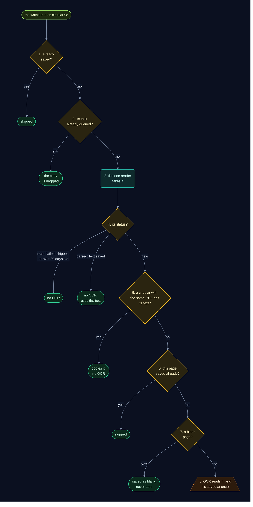

Each guard in plain words:

1. **The watcher saves each circular once.** Each round it asks Postgres for the ids it
   already has, one query per regulator, and skips them. If two rows for the same circular
   were ever tried, the table's unique key (`source`, `source_key`) would refuse the second.
   Only one watcher runs. The PDF is stored in S3 under its fingerprint
   (`rbi/<sha256>.pdf`), so the same file is never stored twice.
2. **One task.** Before it puts "read 98" on the PDF lane, the watcher pins a **mark** in
   Redis: a small note named after the task, `rci:queued:circular_id=98:type=circular.read`
   ([what a mark is](#the-mark-a-key-that-says-a-task-is-waiting)). It uses
   `SET … 1 NX EX 86400`, which means "pin this note, but **only if** no note with this name
   is there yet, and take it down after a day"
   ([SET with NX and EX](#set-with-nx-and-ex-write-it-only-if-it-isnt-there)). Redis answers
   `OK` if it pinned it, and `(nil)` if the mark was already there. `(nil)` means the task is
   already queued or running, so it isn't added again. The mark is deleted when the task is
   finished ([when a mark goes away](#when-a-mark-goes-away-del-or-a-day-later)).
3. **One reader.** The PDF lane has exactly one reader (`replicas: 1`), and the OCR server
   reads one page at a time. So two circulars with the same PDF are always read one after
   the other, never side by side. While it works, the reader also tells Redis "still mine"
   every minute (`XCLAIM`, see [still mine](#xclaim-still-mine)), so no other worker takes the
   task over while the reader is alive.
4. **Status.** Only a circular whose status is `new` is OCR'd. `parsed` means its text is
   saved, so it skips straight to the summary. `read`, `failed` and `skipped` do nothing.
   A circular published more than `LOOKBACK_DAYS` (30) days ago is marked `skipped` and
   never read.
5. **Twin.** If another circular has the same PDF (the same sha256) and its text, the text
   is copied, and so is the summary. No OCR at all.
6. **Page by page.** Each page's text is saved in `ocr_pages` the moment it comes back. A
   retry, a timeout or a new reader carries on from the next page not saved yet. Once the
   whole text is on the circular, those rows are deleted.
7. **Blank pages** (no text, images or drawings) are saved as blank and never sent.
8. **At most `OCR_MAX_PAGES`** (20) pages are read.

After the read, the reader queues **one `circular.assess` per company**. That's the
per-company part ("does it apply to us?", and your policies), and it never touches the PDF.

**Tested** (see [section 12](#12-how-it-was-tested)) by counting every page the real worker
sent to OCR:

| What happens | Pages sent to OCR | Summaries | Embedding calls |
|---|---|---|---|
| a new circular: 3 pages, page 3 blank, 2 companies | **2** (page 3 never) | 1 | 1 |
| the same `circular.read` queued twice before it runs | 2: the second mark wasn't pinned (Redis answered `(nil)`), so it was queued and ran once | 1 | 1 |
| the same `circular.read` delivered again after it's done | **0** | 0 | 0 |
| a second circular with exactly the same PDF | **0**: it copies the text | 0: it copies the summary | 1: its own |
| page 2's request times out | 4 requests for 3 pages: only page 2 again | 1 | 1 |
| a circular older than `LOOKBACK_DAYS` | **0**: skipped | 0 | 0 |
| the reader is killed during page 3 of 4, and another worker takes the task over | 5 requests for 4 pages: pages 1 and 2 are not sent again | 1 | 1 |

The only page ever sent twice is one whose request **never finished** (a timeout, or the
reader died mid-page): its text was never saved, so there's nothing to reuse.

---

## 5. Your company adds a new policy: what's reused, what's new

Company A (an NBFC with four RBI policies) adds **POL-AML**. Here's everything that happens,
and what each step reuses:

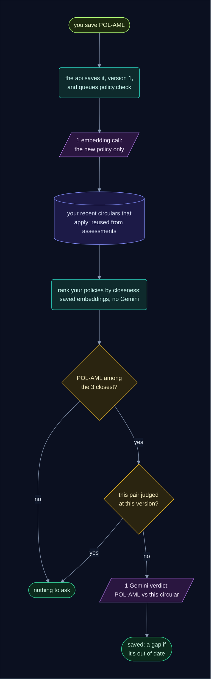

What the check needs, and where it comes from:

| It needs | Reused from | New work |
|---|---|---|
| the circulars' text | `circulars.text`, OCR'd when each circular arrived | none |
| their summaries and obligations | `circulars.summary`, `requirements` | none |
| the circulars' embeddings | `circulars.embedding` | none |
| which circulars apply to you | your `assessments` (done, applies) | none |
| your other policies' embeddings | `policies.embeddings` | none |
| your other policies' verdicts | `policy_checks` | none |
| **the new policy's embedding** | | **1 embedding call** (one piece per 5,000 characters, all in one call) |
| **the new policy against each recent circular where it's in the top 3** | | **1 Gemini verdict each** |

So the cost of a new policy is: **1 embedding call + (recent circulars that apply to you,
from the regulators the policy covers, where it ranks in the top 3) verdicts**. The other
policies are ranked again, but ranking is arithmetic on saved numbers: no Gemini call.

**Tested:** adding POL-AML to company A cost **1 embedding call and 3 verdicts**:
`#1 vs POL-AML v1`, `#2 vs POL-AML v1`, `#3 vs POL-AML v1`. No other pair was asked again,
and nothing was OCR'd, summed up or asked "does it apply?". Circular 4 (a cyber-security
one) wasn't asked, since POL-AML isn't among its 3 closest. The same `policy.check`
delivered again cost **nothing**.

**If you save the policy again while its check is running**, the second save's
`SET … NX` finds the check's mark still there (a mark is deleted only when its task is done),
so Redis answers `(nil)` and no second note is added: two checks of one policy never run at
once ([two saves at the same moment](#two-saves-at-the-same-moment)). Instead,
the running check sees the policy was saved after it started (`updated_at` later than when
it began) and queues itself once more, so your latest text is always checked.

---

## 6. You edit a policy


- **A new control** queues nothing: the worker reads a policy's controls each time it
  judges the policy.
- **A new title** clears the policy's embeddings, so it's embedded again (1 call). Its
  version, and so its verdicts, stay. **Tested:** POL-AML's new title cost 1 embedding
  call and nothing else.
- **A new text** is a new version. It's embedded again, and each recent circular where it
  ranks in the top 3 gets a verdict for version 2, unless the pair already has a gap. The
  version 1 verdicts stay as history. **Tested:** POL-DLP's new text cost 1 embedding call
  and 2 verdicts (`#2 vs POL-DLP v2`, `#4 vs POL-DLP v2`).

---

## 7. A company describes itself, or changes its description

| What you do | What's queued | What's asked again |
|---|---|---|
| sign up | nothing | nothing: there's nothing to judge yet |
| save the same description again | nothing | nothing |
| change only the name | nothing | nothing |
| add or change the description | one `company.refresh` | **only "does it apply?"**, for each circular read in the last 30 days |

A changed description can change which circulars apply to you, so that one question is asked
again; your earlier answers older than the change go back to pending. The OCR text, the
summaries and your verdicts are all kept. For a circular that now applies, only pairs never
judged cost a verdict.

**Tested:** company B saving the same description again cost **nothing**. Changing it cost
**4 "does it apply?" calls** (one per recent circular) and nothing else. A new company, C,
describing itself cost the same 4 calls.

If the description is changed again while its refresh is running, the refresh notices and
queues itself once more, the same way a policy check does.

---

## 8. Reprocess

**Reprocess** on a circular's page is the one button that asks for work to be done again, on
purpose. Even so, it redoes as little as it can:

| The circular | What Reprocess does | What it keeps |
|---|---|---|
| not read yet (failed, or waiting) | queues it to be read again | the text if it has one (status `parsed`), and every page already in `ocr_pages` |
| read | for **your company only**: asks "does it apply?" again, and forgets your "up to date" verdicts so they're asked again | the text, the summary, other companies' answers, your gaps, and every pair that has a gap |

**Tested:** Reprocess on circular 1 for company A cost **1 "does it apply?" and 1 verdict**
(`#1 vs POL-DRP v1`, its one "up to date" pair among the 3 closest). POL-KYC and POL-AML, which
have gaps on it, were skipped, and no gap was added.

---

## 9. Can the same task run twice?

A task is a small note on a lane, a Redis stream, such as "read circular 98" or "check policy
11 for company 1" ([a lane](#a-lane-a-redis-stream)). Here's its life, with the guard at each
point where it could be doubled. Every command in it is explained, with Redis's real answers,
in [Redis, from zero](#3-redis-from-zero):

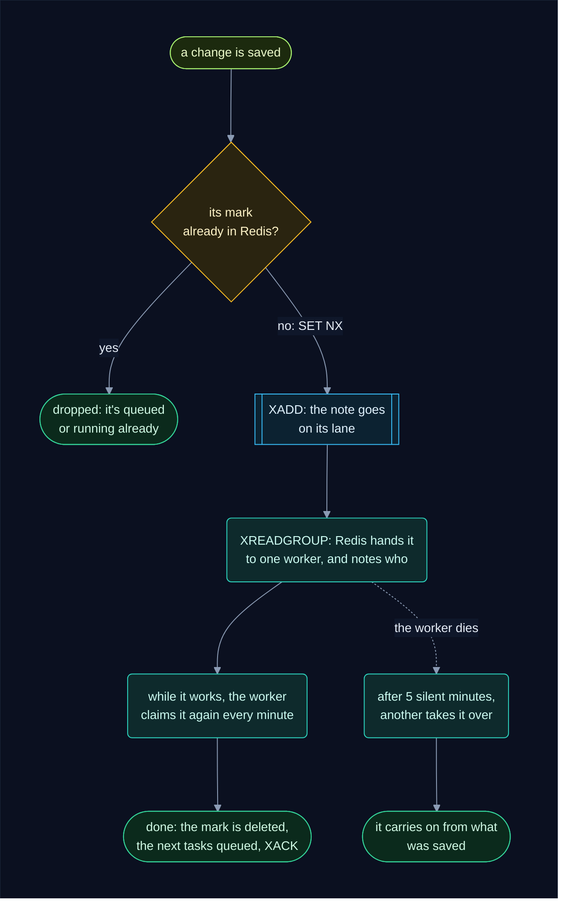

Every way a task could be doubled, and what stops it:

| How it could happen | What stops it | Tested |
|---|---|---|
| the same change is saved twice in a row (two clicks, two saves) | the mark: the second `SET … NX` answers `(nil)`, so the second note is never added ([how](#set-with-nx-and-ex-write-it-only-if-it-isnt-there)) | Redis answered `(nil)` the second time |
| two workers ask for work at the same moment | the group gives each note to one worker and writes its name on the pending list; the other gets `(nil)` ([how](#xreadgroup-a-worker-takes-a-note)) | the second worker got `(nil)` |
| a PDF takes longer than 5 minutes | the reader claims its note again every minute (`XCLAIM`), which resets the note's idle time, so it never looks abandoned while it's alive ([how](#xclaim-still-mine)) | the idle time went back to 0 |
| a worker dies mid-task | its note stays on the pending list; after 5 silent minutes another worker takes it over (`XAUTOCLAIM`, [how](#xautoclaim-taking-over-from-a-silent-worker)), or at once if its own container restarts, and carries on from what was saved | the task was taken over; pages 1 and 2 were not sent again |
| a task arrives again anyway (a re-delivery, `manage.py requeue`, or a mark that expired after a day) | every step looks in Postgres first and finds its answers there | 0 calls for a repeated read, 0 for a repeated policy check |
| two tasks reach the same verdict at the same moment (a policy check and a circular check, say) | the unique key on `policy_checks` refuses the second row; that task retries and then skips the pair | one row; the race cost one extra Gemini call |
| Redis loses its data | `manage.py requeue` queues only the work Postgres shows unfinished; what's already queued is skipped by its mark | it queued 3 refreshes, which cost nothing |
| the watcher sees a circular it already saved | it skips the ids it knows, and the unique key (`source`, `source_key`) would refuse a copy | |

A task that fails for good isn't run again by itself: the same error would most likely
happen again. A person fixes the cause, then presses **Reprocess** or saves again.

---

## 10. Where work can still be repeated

Nothing is perfect. Here is every case where some work is done again, and whether it's
meant to be:

| Case | What's repeated | Meant to be? |
|---|---|---|
| a page's OCR request times out, or the reader dies mid-page | that one page is sent again | yes: its text was never saved |
| **a second circular with exactly the same PDF** (a regulator lists the same file twice, or publishes a corrigendum with the same file) | it reuses the OCR text and the summary, but gets its own embedding (1 call), its own "does it apply?" for each company and its own verdicts, so it can open its own gap for the same policy | **not ideal.** In the test it cost 1 embedding, 2 "does it apply?" calls, 3 verdicts and 1 more gap. It could copy its twin's answers instead |
| two tasks reach the same verdict at the same moment | one extra Gemini call; the second row is refused | rare, and harmless: no duplicate row or gap |
| `GEMINI_EMBEDDING_MODEL_NAME` changes | every circular and policy is embedded again once, the next time it's used | yes: numbers from two models can't be compared |
| a company changes its description | "does it apply?" for every recent circular | yes: the answers may change |
| **Reprocess** | "does it apply?" and the "up to date" verdicts, for your company | yes: that's what it's for |
| Gemini or OCR answers with an error (a 5xx, a timeout, a 429) | LangChain retries the request up to 3 times, then the worker retries the task up to 3 times | yes: only the failed request is repeated, never a finished answer |

---

## 11. How we solved it: the history

The app didn't start like this. Each guard was added when we found a way work could repeat:

```mermaid
%%{init: {"theme": "base", "flowchart": {"diagramPadding": 0, "nodeSpacing": 58, "rankSpacing": 58, "curve": "basis"}, "themeVariables": {"fontSize": "14px", "darkMode": true, "primaryColor": "#16213a", "primaryTextColor": "#e6edf7", "primaryBorderColor": "#475a7a", "lineColor": "#8b9bb4", "secondaryColor": "#1b2436", "tertiaryColor": "#101a2e", "edgeLabelBackground": "#0f172a", "textColor": "#e2e8f0", "clusterBkg": "#0f1728", "clusterBorder": "#2b3a55", "titleColor": "#c4b5fd", "nodeTextColor": "#e6edf7"}}}%%
flowchart TD
    subgraph canvas[" "]
        direction TB
        P(["before 28 Sep: a worker polled<br/>Postgres every 60 s, kept apart<br/>by advisory locks"]) --> Q[["28 Sep: a Redis queue, and<br/>a mark per task instead of locks"]]
        Q --> O[("1 Oct: each OCR'd page<br/>saved in ocr_pages")]
        O --> H("1 Oct: a running task<br/>claimed every minute")
        H --> S("1 Oct: the queue is the<br/>only source of work")
        S --> R("1 Oct: refresh only when<br/>the description changes")
        R --> L[["3 Oct: two lanes, and<br/>exactly one reader"]]
        L --> T(["25 Oct: 17 cases<br/>tested again"])
    end
    classDef svc fill:#0e2a2c,stroke:#2dd4bf,color:#ccfbf1
    classDef data fill:#1c1a47,stroke:#818cf8,color:#e0e7ff
    classDef ext fill:#2a1640,stroke:#c084fc,color:#f3e8ff
    classDef gpu fill:#2d1b0c,stroke:#fb923c,color:#ffedd5
    classDef ask fill:#2a2410,stroke:#fbbf24,color:#fef3c7
    classDef ok fill:#0b2a1c,stroke:#34d399,color:#d1fae5
    classDef bad fill:#2e0f17,stroke:#fb7185,color:#ffe4e6
    classDef start fill:#1c2a0e,stroke:#a7ef6f,color:#ecfccb
    classDef muted fill:#1a2130,stroke:#64748b,color:#cbd5e1
    classDef queue fill:#0c2231,stroke:#38bdf8,color:#e0f2fe
    class P start
    class Q,L queue
    class O data
    class H,S,R svc
    class T ok
    style canvas fill:#0b1020,stroke:#1e293b,color:#0b1020
```

| When | What could repeat, or how it was handled before | The fix | Commit |
|---|---|---|---|
| until 2026-09-28 | A single worker **polled Postgres every 60 seconds** for work. To run several, `locks.py` took Postgres advisory locks (one for the policy library, one for the GPU, one per circular), and a worker skipped anything locked. | | `a22e02f` |
| 2026-09-28 | Polling found work late, and the locks were a second system to get right. | A **Redis Streams task queue**: every change queues its task, and the consumer group gives each task to one worker. | `434b06a` |
| 2026-09-28 | With a queue, the same work could be queued twice (two saves in a row). The locks were still there. | A **mark per task** (`SET … NX`, deleted when the task is done; see [the mark](#the-mark-a-key-that-says-a-task-is-waiting)) replaced the locks: once `XREADGROUP` gives each task to one worker, "skip whatever is locked" has nothing left to do. | `29089bd` |
| 2026-10-01 | Pages already OCR'd were kept **in the worker's memory**. A restarted worker lost them and read every page again. | Each page is **saved in `ocr_pages`** the moment it's read; any worker carries on from there. | `31e3843` |
| 2026-10-01 | A task silent for **30 minutes** was taken over, even if its worker was still reading a long PDF, so the PDF could be read twice. A dead worker's task also waited 30 minutes. | The running worker **claims its task again every minute**; only a task silent for 5 minutes is taken over. | `65f7956` |
| 2026-10-01 | Every 15 minutes a **reconciler** scanned Postgres and queued unfinished work again, on top of the queue: two ways for the same work to arrive. | The queue is the **only source of work**. After Redis loses its data, `manage.py requeue` is run once, by hand. | `f964ed6` |
| 2026-10-01 | **Every company save**, a sign-up or a name change included, queued a `company.refresh`. | Only a description **added or changed** queues it. | `c0fac83` |
| 2026-10-03 | A 2-second check waited 6 minutes behind three PDF reads, all on one queue. | **Two lanes**: PDFs on their own, everything else on the main lane. | `5fdacde` |
| 2026-10-03 | `READERS` allowed more than one reader. Two circulars with the same new PDF could then be OCR'd **at the same time**, because a twin only sees text that's already saved. | **Exactly one reader**, always. | `2349763` |
| 2026-10-25 | | 17 cases tested again against the real worker ([section 12](#12-how-it-was-tested)). | |

---

## 12. How it was tested

On 2026-10-25 these 17 scenarios were run through the **real worker loop**
(`main.serve`: `XREADGROUP`, the task functions, the marks, `XACK`) against a scratch Postgres
and a scratch Redis, never the live ones. The tasks were produced the way the watcher and the
api produce them: the row first, then `queue.enqueue`. Only the OCR server and Gemini were
replaced, by stand-ins that count every call. The world: company A (an NBFC, policies
POL-KYC, POL-DRP, POL-DLP and POL-IT), company B (a stock broker), RBI circulars.

| # | Scenario | OCR pages sent | Summaries | Embedding calls | "Does it apply?" | Verdicts | New gaps |
|---|---|---|---|---|---|---|---|
| 1 | a new circular (3 pages, page 3 blank), 2 companies | 2 | 1 | 1 | 2 | 3 | 1 |
| 2 | the same `circular.read` queued twice before it runs | 2 (ran once) | 1 | 1 | 2 | 3 | 0 |
| 3 | the same `circular.read` delivered again after it's done | 0 | 0 | 0 | 0 | 0 | 0 |
| 4 | a new circular with the same PDF as #1 | 0 | 0 | 1 | 2 | 3 | 1 |
| 5 | page 2's OCR request times out | 4 (3 pages) | 1 | 1 | 2 | 3 | 1 |
| 6 | a circular older than `LOOKBACK_DAYS` | 0 | 0 | 0 | 0 | 0 | 0 |
| 7 | company A adds POL-AML | 0 | 0 | 1 | 0 | 3 | 2 |
| 8 | the same `policy.check` delivered again | 0 | 0 | 0 | 0 | 0 | 0 |
| 9 | POL-AML's title changes | 0 | 0 | 1 | 0 | 0 | 0 |
| 10 | POL-DLP's text changes (version 2) | 0 | 0 | 1 | 0 | 2 | 0 |
| 11 | company B saves the same description again | 0 | 0 | 0 | 0 | 0 | 0 |
| 12 | company B changes its description | 0 | 0 | 0 | 4 | 0 | 0 |
| 13 | a new company C describes itself | 0 | 0 | 0 | 4 | 0 | 0 |
| 14 | Reprocess circular 1 for company A | 0 | 0 | 0 | 1 | 1 | 0 |
| 15 | two workers judge #1 vs POL-DRP at the same moment | 0 | 0 | 0 | 0 | 1 extra | 0 (one row) |
| 16 | the reader is killed during page 3 of 4; another worker takes the task over | 5 (4 pages) | 1 | 1 | 3 (3 companies by then) | 3 | 0 |
| 17 | Redis loses all its data; `manage.py requeue` (3 unfinished refreshes queued) | 0 | 0 | 0 | 0 | 0 | 0 |

At the end: no tasks pending on either lane, no marks left in Redis, no rows left in
`ocr_pages`, and every circular `read` except the old one (`skipped`).

To run such a test yourself, start a scratch Postgres and Redis on other ports, point the
worker's `DATABASE_URL` and `REDIS_URL` at them, replace `ocr.ocr_page` and the four Gemini
calls in `llm.py` with counters, and run `main.serve(r, name, lane, once=True)` for each lane
until both are empty.

---

## 13. Where each guard lives in the code

| Guard | Where |
|---|---|
| skip circulars already saved; one PDF file per fingerprint | `run_source()`, `fetch_new()` in `backend/watcher/main.py` |
| unique keys: circular, assessment, verdict, gap | `backend/common/common/models.py` (`UniqueConstraint`) |
| a mark per task, deleted when the task is done | `enqueue()`, `key()` in `backend/common/common/queue.py`; `run_task()` in `backend/worker/main.py` |
| one worker per task; retries first, then left-behind tasks, then new ones | `next_task()` in `backend/worker/main.py` |
| claim the running task every minute | `keep_claimed()` in `backend/worker/main.py` |
| exactly one reader | `reader: deploy: replicas: 1` in `docker-compose.yml` |
| read only new circulars; skip old ones; reuse a twin's text and summary | `read_circular()`, `twin()` in `backend/worker/pipeline.py` |
| page by page, saved as it's read; blank pages never sent | `ocr_text()` in `pipeline.py`; `pages()`, `blank()` in `backend/worker/ocr.py` |
| embed once per model, and again only when the text or title changes | `embed_circular()`, `embed_policy()` in `pipeline.py`; `update_policy()` in `backend/api/routes/policies.py` |
| ask "does it apply?" once | `assess()`, `add_assessments()` in `pipeline.py` |
| skip pairs judged at this version, or with a gap | `match()` in `pipeline.py` |
| a check or refresh queues itself again if its subject changed meanwhile | `check_policy()`, `refresh_company()` in `pipeline.py` |
| only a changed description queues a refresh | `set_company()` in `backend/api/routes/company.py` |
| Reprocess redoes only your company's answers | `reprocess_circular()` in `backend/api/routes/circulars.py` |
| requeue only unfinished work | `requeue()` in `backend/api/manage.py` |
| what's retried, waited for, or given up | `backend/worker/failures.py` |
